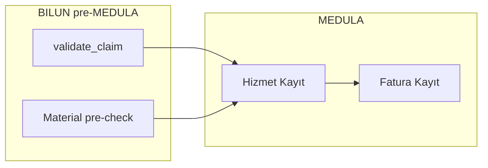

# Material billing: BILUN vs MEDULA boundary (Phase 5)

**Last updated:** 2026-06-02  
**Related:** `docs/medula/medula_bilun_overlap.md`, `reports/sut-fact-check/medula_overlap_gaps.md`, L1.4 fact-check

This document answers: *What does MEDULA block at Hizmet Kayıt, what does BILUN check before submission, and where do they overlap without duplicating recoverable TRY?*

---

## Executive summary

| Layer | MEDULA | BILUN |
|-------|--------|-------|
| **When** | Submission (Hizmet Kayıt / Fatura Kayıt) | Pre-submission analytics + `validate_claim()` |
| **Material blocking** | ICU-group presence, procedure-in-takip, D/E ICU, UBB/ÜTS DTO rules | EK-3B-1 (54), EK-3B-2 (13), partial §3.1–3.2 prose (17 rules), EK-3C/MIAT on claim lines |
| **Overlap verdict** | **ADDITIVE** for annex + prose; **PARTIAL_OVERLAP** for TİTUBB/ÜTS/barcode (different mechanism) |
| **Recoverable TRY** | Do not claim SGK recovery from prose hits — **risk flags** only unless audit-stage proof exists |

The MEDULA web-service manual does **not** name EK-3B-1, EK-3B-2, or §3.1 prose annexes. ICU-group and procedure-presence rules are **documented** in `medula_capabilities.md` (material DTO / blocking sections).

---

## MEDULA material blocking (documented in manual)

From `docs/medula/medula_capabilities.md`:

| Mechanism | Effect | BILUN equivalent? |
|-----------|--------|-------------------|
| **No procedure in takip** | Material invoicing blocked | Partial — BILUN `procedure_pairing_required` when EK-3/C code without linked procedure |
| **ICU A/B/C group absent** | Material billing blocked | **No** — BILUN does not model ICU-group procedure presence for materials |
| **D/E group ICU** | 0 TL + material billing blocked | **No** |
| **UBB barcode mandatory** (since 2008) | DTO validation | **Partial** — BILUN `titubb_uts_incomplete` when claim line sets `titubb_registered` / `uts_registered` false |
| **ÜTS locked material** | Cannot cancel hizmet | **No** |
| **SUT-coded only** (post Oct 2014) | Kodsuz material rejected | **Partial** — keyword + `missing_material_code` prose rules |
| **`barkodSutEslesmeSorgu`** | Barcode↔SUT query API | **Partial** — `3.1.1.(17).barcode_sut_mismatch` keyword rule only |
| **Invoice: material without procedure** | Invoice blocked | Same family as procedure-in-takip |

MEDULA enforces **structural** eligibility (takip state, ICU groups, barcode DTOs). It does **not** document:

- EK-3B-1 bundled consumable **category** matching (54 rows)
- EK-3B-2 non-reimbursable **category** matching (13 rows)
- §3.1.3(8) demirbaş, §3.1.2(7) lost/stolen MIAT, branch-unlisted materials, etc.

Those SUT rules may still apply at **audit** after MEDULA accepts the line — BILUN’s value is catching them **before** send.

---

## BILUN material enforcement (current)

| Component | Rules | MEDULA overlap |
|-----------|------:|----------------|
| `bundling_rules.py` (L1.1) | EK-3B-1 — 54 categories | **ADDITIVE** — not in manual |
| `exclusion_rules.py` (L1.2) | EK-3B-2 — 13 categories | **ADDITIVE** — not in manual |
| `material_bundling_prose.json` (L1.4) | 17 partial §3.1 rules | **ADDITIVE** — prose not in manual |
| `claim_materials.py` (L3.5) | EK-3C-1 preauth, EK-3C-2 MIAT | **PARTIAL_OVERLAP** — MEDULA has MIAT/usage concepts indirectly via ÜTS; not EK-3C annex by name |

### L1.4 prose rules (17) — not MEDULA duplicates

Keywords + claim-field checks only; **not** full §3.1–3.2 corpus (`prose_coverage_tier: partial`).

Examples with **no** documented MEDULA equivalent:

- Demirbaş / tekrar kullanılabilir / garanti renewal (name keywords)
- EK-3/C list membership (`material_not_in_ek3c`, `material_not_in_ek3`)
- Lost/stolen before MIAT (keyword)
- Non-reimbursed procedure materials (keyword)

---

## Additive vs duplicate — decision table

| Scenario | MEDULA at submission | BILUN | Label |
|----------|---------------------|-------|-------|
| Material billed with no procedure in takip | **Blocks** | `procedure_pairing` warning if EK-3/C + data present | **PARTIAL_OVERLAP** — same intent, different layer; BILUN still useful for dry-run |
| Material without ICU A/B/C when required | **Blocks** | No check | MEDULA-only — BILUN cannot replace |
| EK-3B-1 bundled sarf billed separately | Not documented | **Flags** + savings on validator | **ADDITIVE** |
| EK-3B-2 exclusion category | Not documented | **Flags** risk | **ADDITIVE** |
| §3.1 prose (demirbaş, not in EK-3 list, etc.) | Not documented | **Flags** | **ADDITIVE** |
| TİTUBB/ÜTS not registered | UBB/ÜTS DTO rules | `titubb_uts_incomplete` if flags on line | **PARTIAL_OVERLAP** — align claim ingest with MEDULA fields over time |
| Barcode–SUT mismatch | `barkodSutEslesmeSorgu` | Keyword rule | **PARTIAL_OVERLAP** — BILUN advisory unless integrated with MEDULA query |
| Wrong copay / exemption | Invoice copay | EK-1A scan (L2/L3) | **ADDITIVE** (timing) |

**Hard rule for product/copy:** Do not present L1.4 prose `risk_amount` as guaranteed recoverable TRY. MEDULA may still reject or audit-adjust. Use language: *pre-submission compliance exposure*.

---

## Recommended hospital workflow

1. Run `validate_claim` + patient material pre-check in BILUN.
2. Fix EK-3B-1/2 and prose flags before Hizmet Kayıt.
3. Use MEDULA for DTO, ICU-group, and ÜTS/UBB enforcement at submission.
4. Treat remaining §3.1 gaps as audit/legal risk, not automatic MEDULA savings.

---

## Open integration (Category D)

| MEDULA API | BILUN opportunity |
|------------|-----------------|
| `barkodSutEslesmeSorgu` | Feed `validate_claim` barcode checks |
| ICU-group procedure presence | Optional gate before material lines in pre-check |
| `IlacAra`-style material payment codes | If exposed for materials — not in current manual excerpt |

---

## References

- `docs/medula/medula_capabilities.md` — Malzeme DTO, ICU material restrictions, invoice blocking
- `docs/medula/medula_bilun_overlap.md` — full-stack overlap map
- `reports/sut-fact-check/algorithms/L1.4_material_bundling_prose_gap.md`
- `data/gazette/prose_rules/material_bundling_prose.json` — 17 rules
