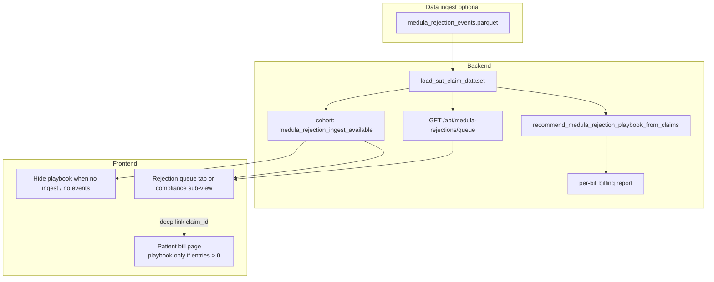

# MEDULA Rebill Playbook — Hide When Empty + Rejection Queue

> **Status:** Draft for review — updated after evaluation
> **Last updated:** 2026-06-15
> **Context:** The patient billing page mixes **proactive SUT optimization** with **reactive MEDULA rejection triage**. Today, patients without `medula_rejection_events` still see a playbook section with an “eksik girdi” notice — noise on an already dense page. When ingest exists, the playbook adds real operational value but has no dedicated workflow surface.
> **Related:** `plans/billing/sgk-uplift-roadmap.md` §3.4, `data/medula/rejection_playbook.json`, `src/bilun/domain/prose_rules/medula_rejection.py`

---

## Task: Separate MEDULA rejection triage from proactive billing optimization

### Goal

1. **Option A:** Never show the MEDULA rebill playbook block on the patient billing page when rejection ingest is absent or the patient has zero rejection events.
2. **Option B:** Add a cohort-level **rejection queue** (fatura masası görünümü) that lists claims with ingested MEDULA rejections and links into the per-bill playbook on the patient workspace.

Done looks like: billing page = SUT optimization only (no empty playbook placeholder); billing desks with MEDULA ingest get a focused queue of rejected claims with corrective steps.

### Success criteria

| # | Criterion | Verify |
|---|-----------|--------|
| 1 | `SENTETIK-HASTA-0001` billing page has **no** MEDULA playbook section | Manual UI / component test |
| 2 | `SENTETIK-HASTA-0012` (demo) shows playbook **only** on the bill with rejection events | Manual UI |
| 3 | Cohort exposes `medula_rejection_ingest_available` (or equivalent) so frontend can hide queue tab when parquet absent | API test |
| 4 | Rejection queue lists claim-level rows: patient, claim, stage, sonuç kodu, matched playbook, rebill permitted | API + UI test |
| 5 | Queue row deep-links to `/patient/{id}?claim={claim_id}` with playbook visible | E2E or manual |
| 6 | Playbook entries still **excluded** from `total_recoverable_try` / SGK uplift KPIs | Existing billing tests green |
| 7 | TR + EN copy distinguishes “SUT optimizasyonu” vs “MEDULA red sonrası rehber” | i18n review |

### Out of scope (this plan)

- Live MEDULA SOAP ingest / real-time rejection polling (continue using `medula_rejection_events.parquet` or future connector).
- Expanding `rejection_playbook.json` beyond pilot templates (separate content project).
- Auto-submitting corrective rebills to MEDULA.
- Merging playbook TRY amounts into revenue recovery totals (by design: operational, not uplift).

---

## Problem statement (verified)

| Surface | Today | Issue |
|---------|-------|-------|
| Patient billing (`/patient/[id]`) | Always renders `MedulaRejectionPlaybookSection` when `medula_rejection_playbook` object exists | `exactness_status === not_applicable` → “eksik girdi” box for ~49/50 synthetic patients |
| Playbook detector | `recommend_medula_rejection_playbook_from_claims` returns `NOT_APPLICABLE` when `ctx.medula_rejection_events` empty | Correct backend behavior; wrong **placement** in UI |
| Optimizer cohort | `total_medula_playbook_entries` counted but no triage queue | Billing desk cannot filter “red almış talepler” |
| Proactive optimizers | Lab, copay, strategy, gazette repricing, etc. | Different lifecycle: no MEDULA rejection required |

**Key distinction to preserve in copy:**

- **Proaktif SUT:** “Göndermeden önce / inceleme sırasında SUT ne diyor?”
- **Reaktif playbook:** “MEDULA reddetti — şimdi ne yapmalıyım?”

---

## Architecture



---

## Phase 1 — Option A: Hide playbook when not actionable (small)

**ROI:** High (immediate UX cleanup)
**Effort:** Small

### 1.1 Frontend — patient billing page

**Files:** `frontend/src/components/patient/SutBillingReportSections.tsx`, `frontend/src/app/patient/[id]/page.tsx`

- Change `MedulaRejectionPlaybookSection` behavior:
  - If `exactness_status === "not_applicable"` → **return `null`** (do not render shell or unavailable notice). This removes the current `isOptionalIngestPending` branch for this section.
  - If `exactness_status === "exact"` and `entries.length === 0` → **return `null`** (already implemented; keep the guard).
  - Only render when `entries.length > 0`.
- Remove `isOptionalIngestPending` branch that shows the “eksik girdi” card for playbook (keep pattern for other optional ingests like procedure capture if still needed).
- Patient page: keep conditional `{activeBillingReport.medula_rejection_playbook && (...)}` — section self-hides when empty.

### 1.2 Frontend — billing summary KPI

**File:** `frontend/src/components/patient/SutBillingReportSections.tsx` (`BillingSummary`)

- `showMedulaPlaybook` already gates on `medulaPlaybookCount > 0` — confirm no change needed.
- Ensure summary grid does not reserve space for playbook when count is 0.

### 1.3 Backend — optional explicit flag (recommended)

**Files:**

- `src/bilun/domain/billing/types.py` (`CohortRecoverySummary`)
- `src/bilun/domain/billing/orchestrator.py` (`compute_all_billing_reports`)
- `src/bilun/cache/builder.py` (cache writer)
- `src/bilun/api/schemas.py` (`BillingReportResponse` optional)

Expose a boolean on cohort health or billing meta:

```python
medula_rejection_ingest_available: bool  # True when parquet loaded with >=0 rows OR build config enables ingest
```

Concrete placement:

1. Add the field to `CohortRecoverySummary` and set it from the claim dataset during cohort aggregation.
2. Persist it into the `cohort_optimization_summary` cache payload.
3. Surface it through `/api/optimization-summary` (the response is permissive, so no schema break).
4. Optionally add the same flag to `BillingReportResponse` so the patient page can hide related UI without a second call.

Purpose: frontend can hide **rejection queue tab** entirely (Phase 2) without probing an empty API.

### 1.4 Tests

- [ ] `MedulaRejectionPlaybookSection` — `not_applicable` renders nothing.
- [ ] `MedulaRejectionPlaybookSection` — exact + empty entries renders nothing.
- [ ] `MedulaRejectionPlaybookSection` — exact + 1 entry renders table (existing demo fixture).
- [ ] Patient page integration test (or RTL snapshot) — 0001 has no playbook block.
- [ ] Cohort summary includes `medula_rejection_ingest_available: true/false` matching parquet presence.

---

## Phase 2 — Option B: Rejection queue workflow (medium)

**ROI:** Highest for billing desks once ingest exists
**Effort:** Medium

### 2.1 Product placement

**Recommendation:** New home tab **`operations`** (or sub-route under **Compliance**) — “Red kuyruğu / MEDULA redleri”.

| Option | Pros | Cons |
|--------|------|------|
| **A. New tab `operations`** | Clear separation from revenue optimization | +1 nav item |
| **B. Compliance tab sub-panel** | Fewer tabs; rejections are compliance-adjacent | Compliance tab already busy |
| **C. Revenue tab sub-panel** | Near money workflows | Misleading — playbook is not SGK uplift |

**Decision for implementation:** Prefer **A** if nav budget allows; else **B** with a top-level panel “MEDULA red kuyruğu” above alert tables.

**Files (if new tab):**

- `frontend/src/lib/constants.ts` (`SutHomeTab` union + `SUT_HOME_TABS` + `parseSutHomeTab`)
- `frontend/src/app/page.tsx` (tab switch chain)
- New `frontend/src/components/tabs/sut/operations/MedulaRejectionQueueTab.tsx`

### 2.2 Backend — queue API

**New route:** `GET /api/medula-rejections/queue`

**Query params:** `page`, `page_size`, optional `sonuc_kodu`, `medula_stage`, `rebill_permitted`, `q` (patient/claim search).

**Response row schema (draft):**

```python
class MedulaRejectionQueueRow:
    rejection_event_id: str
    patient_id: str
    claim_id: str
    episode_id: str
    medula_stage: str
    sonuc_kodu: str
    hata_mesaji: str
    related_procedure_code: str
    rejection_timestamp: date | None
    playbook_matched: bool
    playbook_key: str | None
    sut_anchor: str | None
    rebill_permitted: bool | None
    corrective_steps_tr: list[str]  # only when matched
```

**Build logic:**

1. Load the full exact claim dataset via `load_sut_claim_dataset()` with the same exception handling pattern used by `_safe_load_claim_dataset` (`src/bilun/api/routes/optimization.py:75-91`). If the parquet is absent, return `ingest_available: false`.
2. Iterate `dataset.medula_rejection_events`.
3. Join `claim_headers` for patient metadata (department, dates, claim_type).
4. Run `match_playbook_template(event)` from `medula_rejection.py` (reuse, do not duplicate). **Do not** use `detect_medula_rejection_playbook_entries`, because that helper drops unmatched events and the queue must show them as `playbook_matched: false`.
5. Sort default: `rejection_timestamp` desc, then `claim_id`.

**Empty ingest:** return `{ ingest_available: false, rows: [], total: 0 }` with HTTP 200 — not an error.

**Cache (optional v2):** `medula_rejection_queue_rows` in analytics build if queue latency matters; not required for v1 if event count is small.

### 2.3 Frontend — queue table

**Columns (TR):**

| Kolon | Kaynak |
|-------|--------|
| Hasta | `patient_id` → link |
| Fatura | `claim_id` |
| Red tarihi | `rejection_timestamp` |
| Aşama | `medula_stage` |
| Sonuç kodu | `sonuc_kodu` |
| MEDULA mesajı | `hata_mesaji` (truncated) |
| İşlem | `related_procedure_code` |
| Rehber | matched → playbook key / “şablon yok” |
| Yeniden fatura | Evet/Hayır/— |
| Aksiyon | “İncele” → patient deep link |

**Filters:** sonuç kodu, aşama, yalnızca eşleşen şablon, yalnızca rebill_permitted.

**Empty states:**

- Ingest off → short explanation + link to docs/admin (no error styling).
- Ingest on, zero events → “Red kaydı yok”.

### 2.4 Deep link into patient workspace

**URL contract:** `/patient/{patient_id}?claim={claim_id}&section=medula-playbook`

**Files:** `frontend/src/app/patient/[id]/page.tsx`, `buildSutPatientHref` / billing href helpers

- Add `useSearchParams` to the patient page and read the `claim` query param on mount.
- Set `selectedClaimId` from `claim` when present; ensure `loadScopedReports` fires for the selected bill.
- Update `buildSutPatientHref` (or add `buildSutPatientBillingHref(patientId, claimId)`) so the queue table can generate URLs with the `claim` param.
- Add an `id="medula-playbook"` anchor to `MedulaRejectionPlaybookSection` and scroll/focus it when `section=medula-playbook` is present.
- Playbook will be visible because Phase 1 only renders when entries exist for that bill.

### 2.5 Cohort summary chip (optional)

On **Patients** or **Operations** tab header: badge `N red` when ingest available and N > 0.

Use queue `total` or `CohortRecoverySummary.total_medula_playbook_entries` — align definitions (entries = matched playbook rows, not raw events). If showing the badge on the Patients tab, prefer **matched playbook entries** to keep it consistent with the optimizer KPI. If showing it on an Operations tab, raw event count is also acceptable; document the choice.

### 2.6 Tests

- [ ] API: empty dataset → `ingest_available: false`.
- [ ] API: `SENTETIK-HASTA-0012` → ≥1 row, `playbook_matched: true`, `sonuc_kodu: 1688`.
- [ ] API: unmatched event → row with `playbook_matched: false`.
- [ ] API: pagination + filter combinations behave correctly.
- [ ] Frontend: queue tab hidden when `ingest_available === false`.
- [ ] Frontend: “İncele” link preserves claim selection and scrolls to playbook.

---

## Phase 3 — Copy, chatbot, and content hygiene (small)

### 3.1 i18n

**Files:** `frontend/src/messages/tr/billing.ts`, `en/billing.ts`, new `operations.ts` or `medulaQueue.ts`

- Billing page footer: keep normative SUT note; do not mention MEDULA playbook when hidden.
- Queue tab: subtitle clarifies “reaktif triyaj — SGK artışı değil”.
- Playbook section title optional rename: **“MEDULA red → düzeltici işlem rehberi”** (drop “yeniden fatura” from title if it implies auto-submit). **Decision:** Confirm with Safa before changing the existing TR title (`frontend/src/messages/tr/billing.ts:82` currently says “yeniden fatura”).

### 3.2 Chatbot

**Existing:** `src/bilun/chatbot/medula_kb.py` — `search_playbook_entries`.

- Add tool description: “Use when user asks about a MEDULA sonuç kodu or rejection message.”
- Page context: include queue count when on operations tab; do not inject playbook into patient chat when section hidden.

### 3.3 Optimizer tab

**File:** `frontend/src/components/tabs/sut/optimizer/SUTOptimizerTab.tsx`

- `medula_playbook` KPI: show only when ingest available; else hide stat (mirror Phase 1 pattern).
- Consider whether `action_count` / “recommended actions” should still count hidden playbook entries on the patient page. If the playbook section is hidden but actions still include it, add a footnote or keep the count consistent with visible sections.

---

## Phase 4 — Verification & rollout

### Manual smoke

1. **0001** — billing page: no playbook block; queue tab hidden or empty state.
2. **0012** — queue shows rejection; click through → bill selected → playbook table visible.
3. Regression: SGK uplift, muafiyet farkı, lab sections unchanged on 0001.

### Automated

```bash
.venv/bin/pytest tests/unit/domain/billing/test_medula_rejection_wiring.py -q
.venv/bin/pytest tests/unit/domain/prose_rules/test_medula_rejection.py -q
# After Phase 2:
.venv/bin/pytest tests/unit/api/test_medula_rejection_queue_api.py -q
```

Frontend:

```bash
cd frontend && npm test -- SutBillingReportSections
```

---

## Implementation order (recommended)

| Step | Phase | Delivers |
|------|-------|----------|
| 1 | 1.1–1.2 | Remove noise on billing page immediately |
| 2 | 1.3 | Cohort ingest flag for conditional nav |
| 3 | 2.1–2.3 | Rejection queue API + table |
| 4 | 2.4 | Deep links from queue to patient bill |
| 5 | 3 | i18n + optimizer KPI cleanup |
| 6 | 4 | Smoke + docs update |

---

## Risks & mitigations

| Risk | Mitigation |
|------|------------|
| Users lose visibility that playbook *could* exist | Document in admin/onboarding; queue tab appears when ingest enabled |
| Unmatched rejections clutter queue | Filter “şablon yok”; drive playbook JSON expansion separately |
| Confusion with revenue recovery | Never sum playbook into `total_recoverable_try`; distinct tab + copy |
| Per-bill scoping | Queue is claim-scoped; deep link passes `claim_id` (already supported by bill billing report) |
| Direct deep-link lands on wrong bill or no scroll | Parse `claim` + `section` query params and add anchor id (Phase 2.4) |

---

## Review (fill after implementation)

- [ ] Phase 1 shipped — playbook hidden for 0001
- [ ] Phase 2 shipped — queue live for 0012
- [ ] Deep link verified
- [ ] CI green
- [ ] Safa sign-off on tab placement (operations vs compliance) and TR title wording
