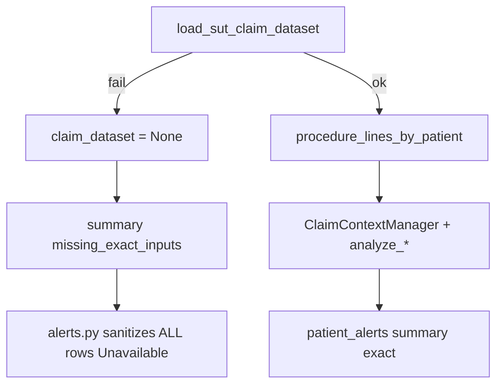

# Optimizer / Cohort Surfaces — Investigation (May 2026)

## Symptoms reported

1. **Cohort patient table** — Age, Recoverable, Priority, Actions mostly `—`; only ~1 patient (e.g. `SENTETIK-HASTA-0003`) populated.
2. **Surcharge Compliance** — All 50 patients `Unavailable` (missing procedure codes/dates).
3. **Copay Rate Compliance** — Same unavailable cohort-wide.
4. **Revenue Recovery** — Lab savings only; Drug/Copay/Strategy `0`; DRG + Drug discount audit unavailable.
5. **Copay Exemptions** — Working (~88% exempt); chat and exemption tab OK.

---

## Root cause map

| Symptom | Primary cause | Layer |
|---------|---------------|--------|
| Surcharge / Copay rate unavailable | **Claim dataset failed to load at cache build** → empty `procedure_lines_by_patient` → summary `missing_exact_inputs` → API sanitizes all rows | Backend regression + cache |
| Drug / Copay / Strategy savings `0` | Same: billing orchestrator gates on `claim_context` / `sut_claim_dataset` | Cache build |
| DRG / Drug discount unavailable | `compute_optimization_summary(claim_dataset=None)` | Cache build |
| Lab savings only | Lab uses `lab_clean` only — **does not need claims** | Expected |
| Age always `—` | Cache reads column `yas`; synthetic anadata has `TANI_YASI` only | Cache build |
| Sex shows `E`/`K` | `CINSIYET` present — **working** | OK |
| Recoverable only top patients | Table joins `revenue_recovery.top_patients` (hard cap **10**) | Frontend/API design |

---

## Critical blocker (fixed): `load_sut_claim_dataset()` crash

After adding `patient_copay_profiles.parquet`, `_copay_profile()` called `_text(row.get("field"))` instead of `_text(row, "field")`.

**Effect:** Every cache build that loads claims throws `TypeError` → caught in `assemble_sut_context` → `claim_dataset = None` → entire claim-backed stack unavailable.

**Verify after fix:**

```bash
.venv/bin/python -c "from src.bilun.domain.claims import load_sut_claim_dataset; ds=load_sut_claim_dataset(); print(len(ds.procedure_lines_by_patient))"
# Expect: 50
```

**Files:** `src/bilun/domain/claims/loader.py` (`_copay_profile`)

**User action:** Rebuild analytics cache after deploying fix.

---

## Surcharge / Copay rate alerts flow



- Build: `src/bilun/cache/sut_context.py` — `build_sut_patient_alerts_cache`
- Gate: `src/bilun/api/routes/alerts.py` — `_sanitize_patient_alert_summary`, `_attach_patient_alert_exactness`
- Stubs: `src/bilun/domain/optimization/surcharge.py`, `copay_rates.py`

Copay **exemption** tab does not need procedure lines (diagnosis + profiles only) — explains why it works while surcharge/copay-rate do not.

---

## Revenue Recovery breakdown

| KPI | Needs | Why zero/unavailable without claims |
|-----|--------|--------------------------------------|
| Lab | `lab_clean` | Works — synthetic lab unbundling scenarios |
| Drug | `drug_claim_lines` | Gated; fallback prescription heuristic often 0 |
| Copay savings | Procedure/drug claim lines + exemption | Exempt ≠ savings; needs billed > payable on lines |
| Strategy | Claim headers/lines | Hard stub without claims |
| DRG panel | Claim lines + packages | Aggregator `claim_dataset=None` |
| Drug audit | Drug claim lines | `validate_drug_discount_tiers(None)` |

Cohort badge `partial_exact` is **expected** when any patient report has non-exact sections (`orchestrator.py` `_finalize_summary_exactness`).

---

## Cohort patient table

**Age:** `_build_sut_patient_meta` used `yas`; synthetic exports `TANI_YASI` (`scripts/synthetic/exporters.py`). Fixed via `TANI_YASI` → `yas` in `_normalize_ana` (`src/bilun/cache/loaders.py`).

**Recoverable / Priority / Actions:** Fixed — table now uses `patient_summaries` (all patients) with API fallback from `patient_billing_report_rows`. Previously joined only `top_patients` (10 patients).

**Fix options (follow-up):**

- `GET /api/patient-billing-summaries` reading `patient_billing_report_rows`, or
- Extend `cohort_recovery_summary` with per-patient summaries at build time.

---

## Recovery checklist

1. Deploy loader + age fixes.
2. Regenerate synthetic data if needed (optional).
3. **Rebuild cache:** `python scripts/bilun/build_cache.py --activate`
4. Restart API.
5. Re-open Optimizer — expect surcharge/copay-rate exact, non-zero drug/copay/strategy where synthetic scenarios allow.
6. Cohort table: age after rebuild; recoverable columns need frontend/API follow-up for all 50 patients.

---

## Out of scope / honest limits

- Strategy savings may remain low even with claims (only ~50% package candidates).
- Copay savings require exempt patients **and** copay-bearing lines with billed > payable.
- Drug savings depend on claim line payable gaps, not catalog-only fallback.
