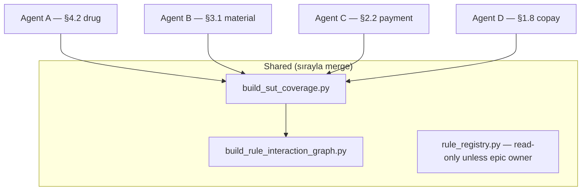

# R5 — Gate B genişletme: paralel epic orchestration

**Parent:** `plans/billing/sut-referans-normatif-plan.md` (Phase R5)  
**Status:** Planning (2026-06-27)  
**Prerequisite:** R1–R4 merged or on branch — honest referans / motora bağlı / encode KPI

---

## “Epic plan” ne demek?

**Epic plan** = büyük, bağımsız bir iş paketinin **tek dosyada yazılı yol haritası**.

| Kavram | Anlamı |
|--------|--------|
| **Task / PR planı** | 1–3 gün, tek PR, dar kapsam (`tasks/todo.md`) |
| **Epic plan** | Haftalar–aylar, birden fazla PR, bir **motor / SUT bölümü** (bu dosya ailesi) |
| **Phase (R1–R5)** | Program seviyesi — R5 = “encode borcunu kapat” programı |

Epic plan şunları içerir: mevcut baseline sayıları, fazlar, definition of done, test stratejisi, **hangi dosyaların kime ait olduğu**, mevcut planla ilişki (extend / replace).

Epic plan **kod yazmaz**; agent veya ekip onu uygular.

---

## Dört paralel epic — özet

| Epic | Plan dosyası | Motor(lar) | Encode bugün | Motor-bound gap | Mevcut plan (extend) |
|------|--------------|------------|-------------:|----------------:|----------------------|
| **A** §4.2 ilaç | `r5-epic-4.2-drug-indication.md` | `drug_indication_prose` | 518 clause | ~1.851 | `drug-indication-4.2.14.C-expansion-plan.md` ✅ çoğu bitti |
| **B** §3.1–3.2 malzeme | `r5-epic-3.1-material-bundling.md` | `material_bundling_prose` | 80 clause | ~35 | `material-bundling-prose-p2-plan.md` ✅ çekirdek bitti |
| **C** §2.2 ödeme | `r5-epic-2.2-payment-method.md` | `payment_method_*` | **0** (manifest yok) | ~88 | `payment-method-compliance-data-fix-plan.md` (runtime; prose trace eksik) |
| **D** §1.8 katılım payı | `r5-epic-1.8-copay-exemption.md` | `copay_exemption_*`, `copay_rate_general` | **0** (manifest yok) | ~60 | `copay-exemption-coverage.md`, `copay-ek1a-ek4d-scope-fix-plan.md` |

**Not:** §3.3 branş malzemesi (`specialty_materials_prose`, 29/32 encoded) bu dörtlünün dışında — malzeme epic’inin **Phase B** olarak aynı agent’a verilebilir veya 5. agent.

Global encode baseline: **639** clause (`has_rule_encoding=true`).

---

## 4 paralel agent — evet, ama kurallarla

Dört agent **aynı anda** çalışabilir; her biri **farklı epic plan** + **farklı dosya sahipliği** alır.



### Agent başına sahiplik (conflict önleme)

| Agent | Sahip olduğu path’ler | Dokunmaması gereken |
|-------|----------------------|---------------------|
| **A §4.2** | `drug_indication_prose.json`, `L4.2_*manifest*`, `drug_indication_*batch*`, `drug_indication_gate_b.py`, `claim_drug_indication.py` | B/C/D JSON + manifest |
| **B §3.1** | `material_bundling_prose.json`, `L1.4_*`, `material_bundling_*batch*` | A/C/D |
| **C §2.2** | `payment_method_2_2.json`, yeni `L2.2_*manifest*`, `payment_method.py` prose extend | A/B/D |
| **D §1.8** | `copay_general_1_8.json`, yeni `L1.8_*manifest*`, `copay_exemption_rules/*` | A/B/C |

### Paylaşılan merge protokolü

1. Her agent kendi epic’inde bitince: **sadece kendi manifest + JSON + batch rules + golden tests**.
2. **Coverage regen:** merge sırasında veya orchestrator agent tek sefer `python scripts/sut/build_sut_coverage.py` + `build_rule_interaction_graph.py`.
3. `scripts/sut/prose/classify.py` — epic owner PR açmadan önce grep; başka epic prefix değiştirmiyorsa dokunma.
4. Tek PR’da iki epic birleştirme — conflict riski; tercih **4 branch → sıralı merge** veya **4 PR + final regen PR**.

### Önerilen branch isimleri

```
feat/r5-epic-4.2-drug
feat/r5-epic-3.1-material
feat/r5-epic-2.2-payment
feat/r5-epic-1.8-copay
```

Base: `feat/sut-referans-normatif` veya `main` (R1–R4 merge sonrası).

---

## Öncelik sırası (iş değeri × hazırlık)

1. **C §2.2** — JSON var, manifest yok; 88 gap; ödeme yöntemi faturalama çekirdeği.
2. **D §1.8** — JSON var (4 rule), status rules kısmen var; 60 gap; copay planları net.
3. **A §4.2** — en büyük gap ama **131+ rule zaten encode**; kalan §4.2 beyond 4.2.14.C + Tier C.
4. **B §3.1** — en küçük gap (35); long-tail corpus batch2.

Paralel çalışma sırası önceliği değiştirmez — hepsi aynı anda başlayabilir.

---

## R5 program definition of done

- [ ] Her epic kendi planındaki “definition of done” maddelerini karşılar.
- [ ] `sut_clause_coverage.parquet`: `has_rule_encoding` global **639 → hedef ≥750** (minimum bar; epic’ler toplamı).
- [ ] `rule_interaction_graph.json` regen; node sayısı parquet ile uyumlu.
- [ ] Rule Database: “Motora bağlı” rozet sayısı düşer; false gap yok (R1–R4 korunur).
- [ ] Fact-check audit satırları L2.2 / L1.8 / L4.2 için **PARTIAL → daha yüksek coverage fraction** (COMPLIANT’a erken atlama yok).

---

## Epic plan dosyaları

- [§4.2 ilaç](./r5-epic-4.2-drug-indication.md)
- [§3.1–3.2 malzeme](./r5-epic-3.1-material-bundling.md)
- [§2.2 ödeme yöntemi](./r5-epic-2.2-payment-method.md)
- [§1.8 katılım payı](./r5-epic-1.8-copay-exemption.md)
