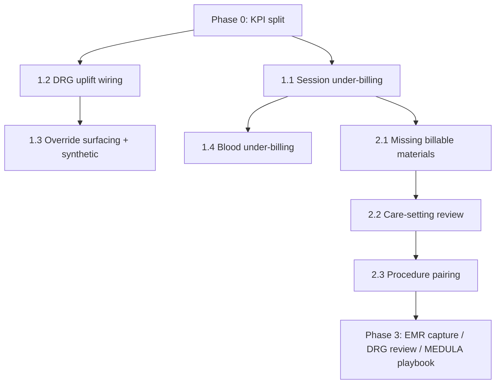

# SGK Uplift Roadmap — Reimbursement Increase (not copay/compliance)

**Status:** Draft for review  
**Last updated:** 2026-06-06  
**Context:** BILUN encodes substantial §2.2 / EK-2 / EK-3 mechanics, but headline KPIs and UI weighting make the product read as copay + compliance. This plan adds **Kurum ödemesi uplift** detectors and honest bucketing before expanding scope.

**Fact-check anchors:** `reports/sut-fact-check/MASTER.md`, `docs/core-system/algorithms_reference.md`

---

## Task: SGK reimbursement uplift program

### Goal

Ship a defensible **SGK uplift** track: algorithms that increase legitimate Kurum ödemesi (or surface missed billable amounts), with KPIs separated from patient copay waiver and audit-risk flags.

### Success criteria

1. `BillingActionReport` exposes `sgk_uplift_try` distinct from compliance adjustment, copay waiver, and audit exposure.
2. `grand_total_recoverable` (or renamed headline) sums **uplift-only** amounts with `savings_basis` / `savings_category` on every TRY field.
3. Session under-billing produces non-zero uplift on synthetic scenarios designed for §2.2.2.B under-billing.
4. DRG `itemized_package_uplift_try` appears on billing report (not optimizer-only) when legally allowed.
5. Cohort charts no longer imply copay is in the same bucket as SGK uplift unless explicitly toggled.
6. Drug generic/passivation optimizers stay **out of scope** (MEDULA overlap); stale L3.2/L2.7 docs updated to match.

### Out of scope (this program)

- EK-4A generic substitution and passivation alerts (MEDULA-owned; removed intentionally).
- Drug discount tier recovery unless a separate **ödeme reconciliation** use case is approved.
- Automatic DRG upcoding / package switching without human coding-review workflow.
- Full §3.1–3.2 prose corpus (continues under L1.4 / L4.4 tracks).

---

## Phase 0 — KPI schema & product honesty (prerequisite)

**ROI:** High (unblocks trust in all later numbers)  
**Effort:** Small–medium

### Problem

| Field today | Issue |
|-------------|--------|
| `total_recoverable_try` | lab (compliance) + strategy only; excludes DRG uplift |
| `savings_by_category` | includes `copay` but `grand_total_recoverable` excludes it |
| DRG `potential_savings_try` | mixes uplift, over-billing risk, heuristic bundled flags |
| Lab hemogram | reduces over-billing, not Kurum increase |

### Subtasks

- [ ] Add `SavingsCategory` enum (or string constants): `sgk_uplift`, `compliance_adjustment`, `patient_copay_waiver`, `audit_exposure`.
- [ ] Extend `BillingActionReport` with explicit totals:
  - `sgk_uplift_try`
  - `compliance_adjustment_try` (lab hemogram, etc.)
  - `audit_exposure_try` (non-recoverable risk; display-only)
  - Keep `patient_copay_waived_try` on `CopayOptimization` (already partially there).
- [ ] Refactor `_sum_exact_recoverable_try()` → `_sum_sgk_uplift_try()`; lab moves to `compliance_adjustment_try` unless we later prove a hemogram *under-billing* case.
- [ ] Update `CohortRecoverySummary`:
  - `savings_by_category`: split `sgk_uplift`, `compliance`, `copay_waiver`
  - `grand_total_recoverable` = uplift only (or rename to `grand_total_sgk_uplift_try`)
- [ ] Frontend: Revenue Recovery / billing summary copy distinguishes the three KPI families.
- [ ] Update `reports/sut-fact-check/algorithms/L3.6_billing_orchestrator.md` + `algorithms_reference.md` §3.6.

### Files

- `src/bilun/domain/billing/types.py`
- `src/bilun/domain/billing/orchestrator.py`
- `src/bilun/api/schemas.py`
- `frontend/src/components/patient/SutBillingReportSections.tsx`
- `frontend/src/messages/{en,tr}/billing.ts`

---

## Phase 1 — Tier 1 uplift (highest ROI, existing infra)

### 1.1 Session pricing under-billing detector

**ROI:** Highest first algorithm  
**Effort:** Medium  
**SUT:** §2.2.2.B (EK-2/C session), §2.2.2.A(5) (EK-2/B itemized)  
**MEDULA overlap:** ADDITIVE (session-fraction advisor)

#### Problem

`detect_session_point_violations()` in `drg_unbundling.py` only flags **over-billing** when `actual_billed > expected_billed`. The inverse — secondary billed **below** allowed fraction — is pure SGK upside.

#### Design

**New function:** `detect_session_underbilling_opportunities()` in `src/bilun/domain/prose_rules/session_pricing.py` (or sibling `session_uplift.py`).

**Inputs per session** (reuse existing helpers):

- `group_procedure_lines_by_session(lines)`
- `compute_session_point_factors(codes, same_incision=..., cross_specialty=...)`
- `detect_cross_specialty_session(billable, claim)` when `cross_specialty is None`
- Primary selection: `_primary_index_by_points(codes)` — compare **billed primary** vs **puan-primary**

**Logic:**

1. For each session with ≥2 billable non-package lines (`procedure_category != "paket"`, `not is_package_included`, `billed > 0`).
2. Resolve expected factors from `compute_session_point_factors`.
3. Identify **puan-primary** line vs **billed-primary** (highest `billed_amount_try` or explicit flag if added later).
4. **Secondary under-billing:** for each secondary line,  
   `expected_billed = primary_billed × (factor_secondary / factor_primary)`  
   if `actual_billed < expected_billed × (1 - tolerance)` →  
   `recoverable_uplift_try = expected_billed - actual_billed`.
5. **Wrong primary uplift (optional v1.1):** if billed-primary ≠ puan-primary, recompute all secondaries against correct primary payable; sum positive deltas (cap at session-level sanity check).

**Output row schema:**

```python
{
    "type": "session_underbilling",
    "claim_id": str,
    "procedure_line_id": str,
    "procedure_code": str,
    "procedure_name": str,
    "session_date": str,
    "primary_procedure_code": str,
    "expected_point_factor": float,
    "expected_billed_try": float,
    "actual_billed_try": float,
    "recoverable_uplift_try": float,
    "savings_category": "sgk_uplift",
    "savings_basis": "sourced",
    "sut_section_id": str,  # e.g. "2.2.2.B.a"
    "rule_id": str,
    "detail": str,
}
```

**Integration:**

- New dataclass block `SessionPricingUplift` on `BillingActionReport` OR fold into `BillingStrategyRecommendation.recommendations` with `type: "session_underbilling"` (prefer **dedicated block** for KPI clarity).
- Wire from `recommend_billing_strategy_from_claims()` or new `recommend_session_uplift_from_claims()` called in `compute_patient_billing_report()`.
- Sum into `sgk_uplift_try` only.

**Tests:**

- Mirror `tests/unit/domain/prose_rules/test_drg_unbundling.py` session over-billing cases with inverted amounts.
- `tests/unit/domain/billing/test_session_uplift.py` — synthetic two-procedure same-session claim.
- Add synthetic scenario tag in `scripts/synthetic/` for under-billed secondary.

**Files:**

- `src/bilun/domain/prose_rules/session_pricing.py` (or `session_uplift.py`)
- `src/bilun/domain/prose_rules/drg_unbundling.py` (import shared tolerance `_BILLING_TOLERANCE = 0.02`)
- `src/bilun/domain/billing/claim_strategy.py` or `claim_session_uplift.py`
- `src/bilun/domain/billing/types.py`, `orchestrator.py`
- `frontend` — new subsection under Billing strategy or “SGK uplift”

---

### 1.2 Wire DRG uplift into billing report KPI

**ROI:** High (code exists; surfacing only + filtering)  
**Effort:** Small–medium  
**SUT:** §2.2.2(2) optional override path + itemized vs package comparison  
**Depends on:** Phase 0 KPI split

#### Problem

`analyze_claim_unbundling()` already sets `itemized_package_uplift_try` when itemized > package and mandated methods allow. This lives in optimizer `detect_drg_unbundling()` only; `potential_savings_try` mixes uplift with audit risk.

#### Design

**Do not** merge raw `potential_savings_try` into headline.

**Extract uplift-only:**

| Source field | Category |
|--------------|----------|
| `itemized_package_uplift_try` | `sgk_uplift` (when `mandated_methods != {"package"}`) |
| `sourced_savings_try` from payment-method **wrong-method corrective** | `sgk_uplift` (subset only) |
| Session/blood **over-billing** `risk_amount_try` | `audit_exposure` |
| `bundled_violations` heuristic | `audit_exposure` |

**New billing block:** `DrgUpliftRecommendation` (or extend strategy with typed rows):

- Per claim: `itemized_package_uplift_try`, `optional_override_savings_try`, `corrective_method_savings_try`
- `savings_basis`: `sourced` | `optional_override` | `heuristic` (never sum heuristic into headline without label)

**Integration:**

- Call `analyze_claim_unbundling()` from `compute_patient_billing_report()` when `claim_context` present (same gate as strategy).
- Add to `sgk_uplift_try`; expose section in `SutBillingReportSections.tsx`.
- Keep optimizer tab for cohort DRG risk; billing report shows **uplift subset** only.

**Tests:**

- `tests/unit/domain/billing/test_drg_uplift_wiring.py` — uplift included, over-billing risk excluded from `sgk_uplift_try`.

**Files:**

- `src/bilun/domain/billing/claim_drg_uplift.py` (thin wrapper)
- `src/bilun/domain/billing/orchestrator.py`
- `src/bilun/domain/optimization/unbundling.py` (optional: export pure uplift helper)

---

### 1.3 Expand §2.2.2(2) optional override surfacing

**ROI:** High for 3rd-tier (basamak 3) hospitals; low on current synthetic data  
**Effort:** Small (mostly UI + synthetic scenarios)  
**SUT:** §2.2.2(2), `DRG_OVERRIDABLE`, `recommendation_kind: optional_override`

#### Problem

`claim_strategy.py` already picks higher legal option for `DRG_OVERRIDABLE`. Demo data is mostly `DRG_MANDATORY` + “Compliant”, so uplift is invisible.

#### Subtasks

- [ ] Ensure `optional_override` rows use `savings_category: sgk_uplift` and `savings_basis: optional_override` (Phase 0).
- [ ] UI: promote override rows in SGK uplift section (not buried in strategy table); keep `overrideScopeNotice` i18n.
- [ ] Synthetic: add `facility_tier=3` + non-star EK-2/C + EK-2/B dual-member procedures where itemized > package (and reverse).
- [x] Chatbot / cohort: surface count of patients with `optional_override` savings > 0.
- [x] Chatbot / cohort: surface `total_drg_uplift` / `total_blood_uplift` patient counts.
- [x] Optimizer KPIs: `n_drg_uplift_patients`, `n_blood_uplift_patients`.

**Synthetic demo patients (regen required after generator changes):**

| Patient | Scenario tag | Uplift type |
|---------|--------------|-------------|
| SENTETIK-HASTA-0002 | `sgk_optional_override_itemized_higher` | §2.2.2(2) optional override |
| SENTETIK-HASTA-0003 | `sgk_optional_override_package_higher` | §2.2.2(2) optional override |
| SENTETIK-HASTA-0004 | `sgk_blood_uplift_yatis` | Blood component under-billing |
| SENTETIK-HASTA-0005 | `sgk_drg_uplift_yatis` | DRG itemized-vs-package (`package_candidate=False`) |
| SENTETIK-HASTA-0006 | `sgk_material_uplift_yatis` | Missing billable material (600150 without OR2640) |

Regenerate claims and rebuild cache:

```bash
cd scripts/synthetic && python3 generate_sut_synthetic_data_v2.py
python3 scripts/bilun/build_cache.py --activate
```

Entry point is **`generate_sut_synthetic_data_v2.py`** — there is no `scripts/synthetic/generate.py`.

**Files:**

- `scripts/synthetic/generators.py` (scenario tags)
- `frontend/src/components/patient/SutBillingReportSections.tsx`
- `src/bilun/domain/billing/claim_strategy.py` (metadata only if needed)

---

### 1.4 Blood component fraction uplift

**ROI:** Medium (niche but clear math)  
**Effort:** Small  
**SUT:** §2.2.2.B-1.e, `blood_component_billable_fraction()`  
**Can ship with 1.1** or immediately after

#### Problem

`detect_blood_component_violations()` flags **over-billing** only (`billed > max_billable`).

#### Design

Mirror session under-billing:

- If `fraction` applies and `billed < max_billable × (1 - tolerance)` → `recoverable_uplift_try = max_billable - billed`.
- Output `type: blood_component_underbilling`, `savings_category: sgk_uplift`.

**Files:**

- `src/bilun/domain/prose_rules/drg_unbundling.py` or `session_pricing.py`
- Same billing uplift block as 1.1

---

### Phase 1 — Explicitly deferred: Drug discount tier recovery

**Decision (2026-06-06):** Out of scope. Generic/passivation removed because MEDULA handles submission-time validation. Tier mismatch (`billed − payable` on drug lines) is **partial MEDULA overlap** and reconciliation-grade unless hospital ödeme data proves systematic gaps. Do not restore `billing/drug.py` in this roadmap.

**Doc hygiene subtask:**

- [ ] Mark `reports/sut-fact-check/algorithms/L3.2_drug_optimizer.md` and `L2.7_drug_discount_validation.md` as **archived / not in tree**.

---

## Phase 2 — Tier 2 engines (medium effort, strong SUT anchor)

### 2.1 Billable-but-missing material detector (inverse EK-3B-1)

**ROI:** High for implants/stents; medium effort  
**SUT:** §3.1 prose, EK-3 lists, L4.4 specialty materials  
**MEDULA overlap:** ADDITIVE (pre-submission “you forgot to bill”)

#### Design

**Detection pattern:**

```
procedure performed (claim procedure line)
AND material category allowed separate billing (NOT ek3b1 bundled; IN ek3 / prose allow-list)
AND no material claim line OR material line billed_amount = 0
→ missed_sgk_revenue_try = gazette_list_price (or ceiling with KDV)
```

**Inputs:**

- `ProcedureClaimLine` + `MaterialClaimLine` join on `procedure_line_id`
- `get_bundled_consumables()` — inverse check
- `check_material_bundling_for_context()` prose rules — pairing predicates
- `lookup_ek3_list_price_try()` + `material_kdv.py` ceiling

**Output:** `MaterialUpliftOpportunity` list on `MaterialPreCheck` or new block.

**Subtasks:**

- [x] Start with **high-value pairing rules** via `material_pairing_uplift.json` (pilot: 600150 → OR2640).
- [x] L4.4 specialty annex pairings: EK-3H PCI stent, ICD, EVAR; EK-3I TAVI/valve; EK-3F-1 hip (7 rules total).
- [ ] Expand pairing catalog with additional §3.3 batches from L4.4 prose manifest.
- [x] Never assert TRY without catalog price (skip when `lookup_ek3_list_price_try` missing).
- [x] Sum priced opportunities into `sgk_uplift_try` + `MaterialUpliftSection` UI.
- [x] Synthetic **SENTETIK-HASTA-0006** (`sgk_material_uplift_yatis`).

**Files:**

- `src/bilun/domain/billing/claim_material_uplift.py` (new)
- `src/bilun/domain/prose_rules/material_bundling.py`
- `plans/billing/specialty-materials-prose-l4.4-plan.md` (coordinate)

---

### 2.2 Care-setting optimizer (inpatient vs outpatient)

**ROI:** Medium; sensitive clinically  
**Effort:** Medium  
**SUT:** §2.2.1.B / §2.2.2  
**Guardrail:** Advisory only — “verify episode type”; never auto-flip Y↔G

#### Design

- Use `infer_care_setting(claim)` vs signals on claim (`visit_type`, `admission_date`, `discharge_date`).
- For each procedure line, compute `resolve_payment_method` under **actual** vs **alternate legally plausible** setting (only where claim metadata ambiguous).
- If alternate setting yields higher **legal** itemized or package total → flag with delta TRY.
- `savings_category: sgk_uplift`, `recommendation_kind: coding_review`.

**Subtasks:**

- [x] Enumerate ambiguous claim patterns from synthetic + real ingest docs.
- [x] Wire to billing report as review rows, not auto-savings in headline until validated.

---

### 2.3 Procedure pairing & add-on rules

**ROI:** Medium–high in surgery/endoscopy; depends on rule encoding  
**Effort:** Medium–large  
**SUT:** §2.2.2, EK-2B modifiers, session pricing extensions

#### Design

- Rule table: if procedure A billed in session, procedure B may be billable at add-on factor.
- Extend prose JSON or new `procedure_pairing_prose.json`.
- Output: `missing_add_on_procedure` with estimated uplift from EK-2B price × factor.

**Subtasks:**

- [x] `procedure_pairing_prose.json` pilot rules (colonoscopy/OGD → polypectomy add-ons).
- [x] `procedure_addon_uplift.py` + orchestrator/UI wiring; de-dupe vs session uplift.
- [x] Synthetic **SENTETIK-HASTA-0008** (`sgk_procedure_addon_kolonoskopi`).

**Coordinate with:** Phase 1.1 session infrastructure.

---

## Phase 3 — Strategic bets (high value, guardrails required)

### 3.1 Procedure capture completeness (EMR vs claims)

**ROI:** Largest real-world lever  
**Effort:** Large — **data product bet**, not a billing-module tweak

#### Prerequisites

- Ingest: EMR/OR procedure log or Hizmet Kayıt intent log ≠ `procedure_claim_lines`
- Match on `procedure_code`, `service_date`, `claim_id`, provider

#### Output

`capture_gap_try` — sum of EK-2B/EK-2C prices for performed-not-submitted lines.

**Not in Phase 1–2** until ingest contract exists (`plans/data/claim-data-integration.md` extension).

- [x] Parquet contract `performed_procedure_lines.parquet` + loader (optional file)
- [x] `capture_gap_try` display-only KPI + `ProcedureCaptureGapSection` UI
- [x] Synthetic **SENTETIK-HASTA-0009** (`sgk_procedure_capture_kolonoskopi`)
- [ ] Hospital EMR connector / live ingest pipeline

---

### 3.2 DRG / package code adequacy review

**ROI:** High but reputationally dangerous  
**Effort:** Large  
**Guardrail:** `recommendation_kind: documentation_review` only; no auto-switch; cite ICD-10 + procedure evidence

#### Design

- Given `primary_icd10` + procedure set, enumerate **legitimate** EK-2/C candidates (not “highest price wins”).
- Flag **under-coded** packages only when clinical procedure set ⊇ package minimum procedure footprint.
- Human reviewer workflow in UI.

**Rank:** After Phase 1–2 operational detectors.

- [x] `drg_package_adequacy_prose.json` footprint contract + detector
- [x] `package_adequacy_review_try` display-only KPI + `DrgPackageAdequacyReviewSection` UI
- [x] Synthetic **SENTETIK-HASTA-0010** (`sgk_package_adequacy_undercoded`)
- [ ] Full EK-2/C footprint corpus from gazette (pilot rules only)

---

### 3.3 Gazette repricing opportunity (prospective)

**ROI:** Medium for high-volume codes after tebliğ  
**Effort:** Medium  
**Build on:** `optimization/temporal.py`

#### Design

- Cross patient `procedure_claim_lines` service dates with `effective_date` price increases.
- Flag claims where `expected_payable_try` used stale gazette price post-amendment.
- Only where rebilling/adjustment is legally permitted (prose gate).

- [x] `gazette_repricing_prose.json` rebill gate + `gazette_repricing.py` detector
- [x] `gazette_repricing_try` display-only KPI + `GazetteRepricingSection` UI
- [x] Synthetic **SENTETIK-HASTA-0011** (`sgk_gazette_repricing_600150`)
- [ ] Full amendment calendar / all EK-2B codes (pilot: post-2026 tebliğ increases only)

---

### 3.4 MEDULA rejection → corrective rebill playbook

**ROI:** Highest operational value for billing desks  
**Effort:** Large (greenfield)  
**MEDULA overlap:** ADDITIVE

#### Design

- Ingest: MEDULA rejection codes + claim snapshot.
- Map to SUT clause + corrective action template (not auto-rebill).
- Knowledge base + optional chatbot tool (`plans/chatbot/chatbot-redesign.md`).

**Not dependent on Phase 1 math; can parallelize as content/MEDULA ingest project.**

- [x] `data/medula/*.json` knowledge base + `rejection_playbook.json`
- [x] Optional `medula_rejection_events.parquet` ingest + loader
- [x] `medula_playbook_entry_count` display-only KPI + `MedulaRejectionPlaybookSection` UI
- [x] Synthetic **SENTETIK-HASTA-0012** (`medula_rejection_1688_molecular_microbiology`)
- [ ] Live MEDULA SOAP ingest; full rejection code corpus

---

## Recommended build order



| Order | Item | Phase | Est. effort |
|------:|------|-------|-------------|
| 0 | KPI schema split | 0 | S–M |
| 1 | Session under-billing | 1.1 | M |
| 2 | DRG uplift-only wiring | 1.2 | S–M |
| 3 | Optional override surfacing + synthetic | 1.3 | S |
| 4 | Blood component under-billing | 1.4 | S |
| 5 | Missing billable materials | 2.1 | M–L |
| 6 | Care-setting review | 2.2 | M |
| 7 | Procedure pairing add-ons | 2.3 | M–L |
| 8 | Procedure capture (EMR) | 3.1 | XL |
| 9 | DRG adequacy review | 3.2 | L |
| 10 | Gazette repricing ops | 3.3 | M |
| 11 | MEDULA rejection playbook | 3.4 | L |

---

## Verification checklist (per phase)

- [ ] Unit tests for each new detector (positive, negative, tolerance edge).
- [ ] `sgk_uplift_try` never includes `audit_exposure` or lab compliance unless explicitly reclassified.
- [ ] Synthetic scenarios produce at least one non-zero uplift patient per Phase 1 feature.
- [ ] Fact-check stub updates for new algorithm IDs (e.g. L3.7 session uplift).
- [ ] Frontend shows `savings_basis` footnote on uplift rows.
- [ ] Cohort `grand_total` equals sum of per-patient `sgk_uplift_try` when all blocks exact.

---

## Review section

| Date | Reviewer | Notes |
|------|----------|-------|
| 2026-06-06 | Draft | Drug tier recovery excluded per product decision; Phase 0 prerequisite added |
