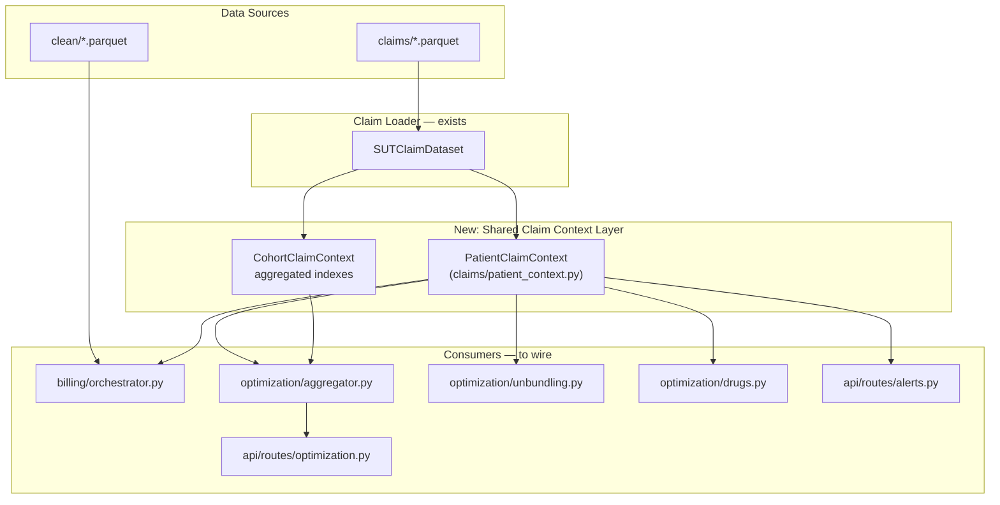

# Claim Data Integration Plan

## Executive Summary

Synthetic v2 claim Parquets (`data/synthetic/sut/claims/`) already contain the
inputs needed for most SUT Optimizer and Billing surfaces: 778 procedure lines,
338 drug lines, 160 material lines, and 138 claim headers with admission dates
and package flags. The frontend shows **Unavailable** because **backend modules
do not consume those Parquets**, not because the data is missing.

This plan wires existing claim-line data through cache → billing → optimization
→ API → frontend, reusing the per-patient claim-context pattern that already
powers surcharge/copay compliance on individual patients.

---

## Problem Statement

| Symptom (UI) | Root cause | Data exists? |
|--------------|------------|--------------|
| Cohort surcharge/copay UNAVAILABLE | `aggregator.py` hardcodes missing inputs; API `_sanitize_optimization_summary` overwrites cache | Yes — procedure lines |
| Billing drug section UNAVAILABLE | `_optimize_drug_costs` uses `recete_clean` only; never reads `drug_claim_lines`; defaults to `missing_exact_inputs` | Yes — 338 drug lines |
| Billing copay section UNAVAILABLE | `_optimize_copay` sets exemption only; never computes savings from claim lines | Yes — procedure + drug lines |
| Billing strategy UNAVAILABLE | `_recommend_billing_strategy` is a hard gate stub | Yes — headers + itemized lines |
| DRG unbundling UNAVAILABLE | `detect_drg_unbundling()` returns stub | Yes — bundled lines + package flags |
| Drug discount audit UNAVAILABLE | `validate_drug_discount_tiers()` returns stub | Yes — drug lines + tiers |
| Cohort Compliance Alerts summary UNAVAILABLE | `alerts.py` sanitization overwrites exact cache summaries | Yes — alerts cache already exact per patient |
| Lab savings degraded (7.20 TRY default) | `lab_clean` uses SUT codes; optimizer expects human names; no lab↔claim linkage in Parquet | Partial — codes exist, naming broken |
| Materials pre-check generic | `_precheck_materials` samples EK-3 catalog by ICD chapter, ignores billed materials | Yes — 160 material lines |

**Conclusion:** Priority is **integration**, not synthetic data regeneration.

---

## Target Architecture



### Design principles

1. **Reuse existing patterns** — mirror `build_surcharge_claim_context` /
   `ClaimContextManager` rather than inventing parallel data paths.
2. **Exactness is earned, not defaulted** — set `exactness_status = "exact"`
   only when claim lines are present and algorithm uses them; keep
   `missing_exact_inputs` for `real_claims` mode without lines.
3. **Single cache build pass** — load `SUTClaimDataset` once in
   `assemble_sut_context`; pass indexes into billing assembly (no second disk read).
4. **No silent fabrication** — if claim context is absent, keep explicit
   unavailable metadata (current behavior is correct; wiring should narrow the gap).
5. **Synthetic and real share one path** — same integration code for
   `synthetic_demo` and future `real_claims`.

---

## Phase 0: Foundation — Patient Claim Context

**Goal:** One typed bundle passed to all billing/optimization modules.

### 0.1 New module: `src/bilun/domain/claims/patient_context.py`

> **Naming:** Use `patient_context.py`, not `context.py`, to avoid colliding with
> the existing optimization pattern in `optimization/claim_context.py` +
> `build_surcharge_claim_context`.

```python
@dataclass(frozen=True)
class PatientClaimContext:
    patient_id: str
    claims: tuple[ClaimHeader, ...]
    procedure_lines: tuple[ProcedureClaimLine, ...]
    material_lines: tuple[MaterialClaimLine, ...]
    drug_lines: tuple[DrugClaimLine, ...]
    diagnoses: tuple[ClaimDiagnosis, ...]

def build_patient_claim_context(
    patient_id: str,
    dataset: SUTClaimDataset,
) -> PatientClaimContext | None: ...

def build_cohort_claim_context(
    dataset: SUTClaimDataset,
) -> CohortClaimContext: ...
```

### 0.2 Extend cache assembly

| File | Change |
|------|--------|
| `src/bilun/cache/sut_context.py` | Already loads claim dataset; expose `claim_dataset` on returned dict (partially exists) |
| `src/bilun/cache/billing_context.py` | Accept optional `claim_dataset` or pre-built `patient_claim_contexts` |
| `src/bilun/cache/context.py` | Pass claim indexes from `assemble_sut_context` into `assemble_billing_context` |

### 0.3 Extend billing orchestrator signature

```python
def compute_patient_billing_report(
    pid: str,
    *,
    claim_context: PatientClaimContext | None = None,
    patient_lab_tests: list[str] | None = None,
    ...
) -> BillingActionReport:
```

`compute_all_billing_reports(cache)` builds `PatientClaimContext` per patient from
`cache["sut_claim_dataset"]`.

### Verification

- [ ] Unit test: `build_patient_claim_context` returns non-None for `SENTETIK-HASTA-0001`
- [ ] Unit test: empty patient returns None; orchestrator falls back to current unavailable behavior

---

## Phase 1: Cohort Optimization Summary (Compliance Alerts tab)

**Goal:** Cohort-level surcharge, copay rate, DRG, and drug panels show exact
findings when claim data is loaded — matching per-patient behavior.

### 1.1 Fix `optimization/aggregator.py`

Replace hardcoded unavailable blocks with cohort aggregation:

| Feature | Implementation |
|---------|----------------|
| Surcharge exposure | Loop patients; `ClaimContextManager` + `analyze_surcharge_exposure`; aggregate `n_applicable_procedures`, coverage rate |
| Copay rate exposure | Same pattern with `analyze_copay_rate_exposure` |
| DRG unbundling | Delegate to Phase 4 implementation; until then call real function |
| Drug discount | Delegate to Phase 4 |

Accept optional `claim_dataset: SUTClaimDataset | None` parameter. When None,
preserve current unavailable stubs (for tests / real mode without claims).

### 1.2 Remove destructive API sanitization

| File | Change |
|------|--------|
| `src/bilun/api/routes/optimization.py` | Delete or gate `_sanitize_optimization_summary` — return cache payload as-is when claim-backed exactness is present |

### 1.3 Fix alerts summary sanitization

| File | Change |
|------|--------|
| `src/bilun/api/routes/alerts.py` | `_sanitize_patient_alert_summary` should only overwrite when `surcharge_exactness_status` / `copay_rate_exactness_status` are genuinely non-exact in cache |

Cache already computes exact per-patient counts in `build_sut_patient_alerts_cache`
when `procedure_lines_by_patient` is populated — verify summary row written to
DuckDB preserves `EXACTNESS_STATUS_EXACT`.

### Verification

- [ ] `GET /api/optimization-summary` returns surcharge/copay with `exactness_status: exact` in synthetic_demo mode
- [ ] Compliance Alerts cohort cards show patient counts, not UNAVAILABLE
- [ ] Frontend `SUTOptimizerTab` cohort panels render exact badges

---

## Phase 2: Billing — Drug Optimization

**Goal:** Drug section uses exact `drug_claim_lines` with billed amounts and
`discount_tier_expected`; savings computed from claim data, not prescription names alone.

### 2.1 New billing helper (e.g. `billing/drug_claims.py` using `PatientClaimContext`)

```python
def optimize_drug_from_claims(
    ctx: PatientClaimContext,
) -> DrugOptimization:
```

Logic:

1. For each `DrugClaimLine`: compare `billed_amount_try` vs EK-4A cheapest
   equivalent in same `equivalence_group` at claim date.
2. Savings = `billed - expected_payable` when current drug is not cheapest tier.
3. Set `exactness_status = "exact"` when `ctx.drug_lines` non-empty.
4. Fall back to current `_optimize_drug_costs(recete names)` only when no claim
   lines — keep `missing_exact_inputs`.

### 2.2 Wire orchestrator

```python
if claim_context and claim_context.drug_lines:
    report.drug = optimize_drug_from_claims(claim_context)
else:
    report.drug = _optimize_drug_costs(pid, patient_drug_names or [])
```

### Verification

- [ ] Patient billing report drug section: `exactness_status: exact` for synthetic patients
- [ ] `total_drug_savings > 0` for at least some patients with tier spread
- [ ] Cohort revenue recovery shows non-zero drug savings category

---

## Phase 2.5: Billing Aggregator — Cohort Revenue Recovery

**Goal:** Ensure per-patient drug/copay/strategy wiring (Phases 2–4) propagates
to the Revenue Recovery dashboard without a separate aggregation path.

### Why this phase exists

`CohortRecoverySummary` is already computed inside
`billing/orchestrator.py:compute_all_billing_reports` by summing per-patient
`BillingActionReport` fields (`total_lab_savings`, `total_drug_savings`, etc.).
There is **no second aggregation layer** — but the chain must be verified end-to-end:

```
PatientClaimContext
  → compute_patient_billing_report (Phases 2–4)
  → compute_all_billing_reports (sums reports)
  → assemble_billing_context → ctx["revenue_recovery"]
  → cache/builder.py writes cohort_recovery_summary
  → GET /api/revenue-recovery reads cache JSON
```

### 2.5.1 Wire claim context at the aggregator entry point

In `compute_all_billing_reports`:

1. Read `cache["sut_claim_dataset"]` (passed from Phase 0 cache assembly).
2. Build `PatientClaimContext` per patient before `_build_report(pid)`.
3. Pass into `compute_patient_billing_report(..., claim_context=ctx)`.

### 2.5.2 Verify exactness propagation on summary

`_finalize_summary_exactness(summary, reports)` already rolls up report-level
exactness. After Phases 2–4:

- Expect `summary.total_drug_savings > 0` and `summary.total_copay_savings > 0`
  for synthetic_demo when algorithms are wired.
- Expect `summary.exactness_status` to move toward `"exact"` only when **all**
  non-partial sections (lab may stay exact; materials may stay partial) are exact.
- Confirm `cache/builder.py` persists `revenue_recovery` without stripping fields.

### 2.5.3 API smoke check

| Endpoint | Assert |
|----------|--------|
| `GET /api/revenue-recovery` | `savings_by_category.drug > 0`, `copay > 0` after Phases 2–3 |
| Same payload | `exactness_status` not degraded by API layer (no sanitizer on this route) |

### Verification

- [ ] Cache `cohort_recovery_summary` JSON contains non-zero drug/copay/strategy totals
- [ ] Frontend Revenue Recovery pie/table shows multi-category savings (not lab-only)

---

## Phase 3: Billing — Copay Optimization

**Goal:** Copay section computes visit/Rx copay savings from exact claim lines.

### 3.1 Extend `_optimize_copay`

Add optional `claim_context: PatientClaimContext | None`:

| Input | Use |
|-------|-----|
| EK-1A exemption (existing) | Skip copay when exempt |
| Procedure lines with `copay_rate_applicable` + `copay_rate` | Sum `(billed * copay_rate)` overcharge vs normative |
| Drug lines | Rx copay component if applicable |

Reference synthetic `expected_payable_try` as ground truth for demo mode validation.

Set `exactness_status = "exact"` when procedure lines present.

### Verification

- [ ] Copay section no longer shows missing_inputs for synthetic patients
- [ ] Exempt patients (EK-1A) still show exemption without fabricated savings
- [ ] Non-exempt outpatient patients show computed copay opportunity

---

## Phase 4: Billing Strategy + DRG Unbundling

**Goal:** Package vs itemized comparison and unbundling risk use claim headers
and itemized procedure lines.

### 4.1 Implement `_recommend_billing_strategy`

**Per-claim algorithm** (for each `ClaimHeader` where `package_candidate=True`
and `admission_date` is not null):

1. Filter `PatientClaimContext.procedure_lines` to this `claim_id`.
2. **Itemized total** — sum `expected_payable_try` for lines where:
   - `procedure_category != "paket"`
   - `is_package_included == False` (exclude bundled-in-package lines)
3. **Package total** — sum `expected_payable_try` for lines where:
   - `procedure_category == "paket"`
   - (If no package line exists, fall back to `get_drg_package_price_for_date`
     using `primary_icd10` + `admission_date` from the claim header.)
4. **Compare:** `savings_try = abs(itemized_total - package_total)`;
   recommend whichever total is lower (cheaper for SGK / higher recovery for provider
   depending on perspective — document which side BILUN optimizes for).
5. Set `exactness_status = "exact"` when at least one package-candidate claim
   has both itemized and package totals computable.

**Parquet fields used explicitly:**

| Field | Role |
|-------|------|
| `ClaimHeader.package_candidate` | Gate which claims enter comparison |
| `ClaimHeader.admission_date` | DRG price lookup date |
| `ClaimHeader.primary_icd10` | DRG group mapping fallback |
| `ProcedureClaimLine.procedure_category` | Distinguish `"paket"` vs itemized |
| `ProcedureClaimLine.is_package_included` | Exclude zero-pay bundled lines from itemized sum |
| `ProcedureClaimLine.expected_payable_try` | Totals for comparison |

Output per claim:

```python
{
    "claim_id": "...",
    "recommendation": "package" | "itemized",
    "package_total_try": float,
    "itemized_total_try": float,
    "savings_try": float,
    "detail": "...",
}
```

Reuse logic patterns from `src/bilun/domain/analytics/drg.py` where possible.

### 4.2 Implement `detect_drg_unbundling`

Replace stub in `optimization/unbundling.py`:

- Find claims where itemized lines exist alongside `package_candidate=True`
- Flag bundled lines (`is_package_included=True`) with non-zero billed that
  should be $0
- Compare package payable vs sum of unbundled itemized payables
- Return exact findings with `exactness_status: exact` when claim context present

### Verification

- [ ] Billing strategy section exact for inpatient synthetic patients
- [ ] Patient optimization DRG panel shows risk findings (not Unavailable)
- [ ] Cohort DRG unbundling card populated

---

## Phase 5: Drug Discount Validation (Optimizer)

**Goal:** EK-4A audit panel validates discount tiers on actual drug claim lines.

### 5.1 Implement `validate_drug_discount_tiers`

Accept optional cohort drug lines from `CohortClaimContext`:

| Check | Rule |
|-------|------|
| Tier match | `discount_tier_expected` on line matches EK-4A tier for drug code at claim date |
| Equivalence | Drug code belongs to stated `equivalence_group` |
| Payable math | `expected_payable_try == billed * (1 - tier)` within tolerance |

Return cohort summary: N claims validated, N tier mismatches, top savings opportunity.

### Verification

- [ ] Optimizer Drug Discount Audit panel: `Validation State: exact`
- [ ] Patient Findings table populated

---

## Phase 6: Materials Pre-Check (Patient-Specific)

**Goal:** Show this patient's billed materials, not generic catalog samples.

### 6.1 Extend `_precheck_materials`

When `claim_context.material_lines` present:

| Check | Source |
|-------|--------|
| Pre-auth required | Match `material_code` against EK-3C-1 |
| MIAT restricted | Match against EK-3C-2 |
| Bundled / payable | Use `is_bundled`, `expected_payable_try` from claim line |
| Ceiling | Compare billed vs gazette price for code |

Keep `partial_exact` if ceiling heuristics remain; narrow
`required_inputs_missing` to only genuinely missing inputs.

### Verification

- [ ] Patient with ortho materials shows their actual SUT codes in pre-check
- [ ] Patient without materials shows empty lists, not unrelated prosthetics

---

## Phase 7: Lab Integration Fix

**Goal:** Lab optimization uses correct gazette prices and links to claim procedure lines.

### 7.1 Generator export fixes (`generate_sut_synthetic_data_v2.py`)

| Export | Add |
|--------|-----|
| `procedure_claim_lines.parquet` | `lab_result_id`, `lab_billing_status` from Excel linkage |
| `lab_clean.parquet` | Optional: `lab_result_id`, `faturalama_durumu` |

### 7.2 Lab name resolution — pre-flight check (completed)

Verified against committed v2 Parquets:

| Check | Result |
|-------|--------|
| Lab `procedure_code` format in `procedure_claim_lines.parquet` | **100% `L*` prefix** (272/272 lab lines) |
| `lookup_procedure_code("L108970")` in `catalog.py` | **Exact match** → name + `price_try` (111.93 TRY) |

**Conclusion:** Generator codes are compatible with `lookup_procedure_code`.
The 7.20 TRY default in the UI is **not** a format mismatch — `_optimize_lab_billing`
uses human-readable `BILUN_TO_SUT_CODE` names while `lab_clean.SUB_CODE` holds
raw SUT codes (lower-cased to `l108970` in the cache normalizer).

**Recommended fix (Option B — preferred):** Teach `_optimize_lab_billing` to detect
`L*` / `l*` test names and resolve price via `lookup_procedure_code` before falling
back to name-based gazette lookup. Avoids duplicating names in `_clean_lab` and
works for both clean tables and claim procedure lines.

Option A (map names in `_clean_lab` export) remains valid but duplicates logic;
use only if lab billing must work without touching `lab.py`.

### 7.3 Billing lab exactness

When lab procedure lines exist on claim context, cross-check billed lab lines vs
`lab_clean` duplicates — flag using claim-line amounts, not defaults.

### Verification

- [ ] Lab table shows real SUT codes and non-uniform gazette prices
- [ ] Loader `_validate_lab_linkage` passes on regenerated Parquets
- [ ] Savings totals increase vs flat 7.20 TRY default

---

## Phase 8: Test & Validation Infrastructure

**Goal:** CI enforces integration; synthetic data validated at v2 scale.

### 8.1 Update tests

| File | Change |
|------|--------|
| `tests/unit/domain/claims/test_loader.py` | Assert v2 scale (138 claims) or pin small fixture subset |
| `tests/unit/domain/test_optimization_claim_context.py` | Use `SENTETIK-HASTA-0003` IDs |
| `tests/unit/domain/test_billing_strategy_exactness.py` | Add positive case with mock `PatientClaimContext` |
| New: `tests/unit/domain/billing/test_claim_integration.py` | Golden tests for each billing section exactness |
| New: `tests/unit/domain/optimization/test_cohort_claim_integration.py` | Cohort summary exact with synthetic dataset |

### 8.2 End-to-end exactness propagation test (high leverage)

One API-level test after cache build with `synthetic_demo` fixture:

```python
def test_optimization_summary_exact_after_cache_build(seeded_cache):
    summary = get_optimization_summary()
    assert summary["surcharge_exposure"]["exactness_status"] == "exact"
    assert summary["copay_rate_exposure"]["exactness_status"] == "exact"
    assert summary["data_source"]["mode"] == "synthetic_demo"
```

Pattern: seed DuckDB cache from real synthetic Parquets (see
`tests/unit/api/test_sut_cache_concurrency.py:_seed_sut_cache`), rebuild with
claim dataset loaded, hit route **without** `_sanitize_optimization_summary`
overrides. Catches regressions in aggregator + API + cache chain in one assertion.

### 8.3 Update validator

`scripts/synthetic/validate_sut_synthetic_data.py`:

- Default workbook: `sentetik_sut_v2_50_hasta.xlsx`
- Scale checks: 50 patients, 100+ claims, surcharge/copay coverage
- Fail if workbook missing (no silent pass)
- Parquet cross-reference: lab linkage, prescription IDs

### 8.4 Frontend test IDs

Update `SENTETIK-HASTA-001` → `SENTETIK-HASTA-0001` in frontend tests.

### Verification

- [ ] `pytest tests/unit/domain/` green
- [ ] `python scripts/synthetic/validate_sut_synthetic_data.py` passes
- [ ] Cache rebuild succeeds: `python -m src.bilun.cache.builder` (or project equivalent)

---

## Phase 9: Cache Rebuild & Frontend Verification

**Goal:** End-to-end demo matches plan definition of done.

### Manual test checklist

| Surface | Expected after integration |
|---------|---------------------------|
| Optimizer → Compliance Alerts (cohort) | Surcharge + copay exact with counts |
| Optimizer → Revenue Recovery | Lab + drug + copay + strategy savings (not lab-only) |
| Optimizer → DRG Unbundling | Risk findings, not Unavailable |
| Optimizer → Drug Discount Audit | Validation exact, drug claim count > 0 |
| Patient billing → Drug | Exact, recommendations from claim lines |
| Patient billing → Copay | Exact or exempt |
| Patient billing → Billing strategy | Recommendations for inpatient claims |
| Patient billing → Materials | Patient-specific billed materials |
| Patient billing → Lab | Real prices, SUT codes populated |

---

## Out of Scope

1. **Real hospital claim ingestion** — separate `real_claims` mode pipeline
2. **Temporal price validation across gazette versions** — needs dated price history wiring (Feature 4, partially exists)
3. **Rule engine vs `expected_rule_outputs` assertions** — valuable but separate test harness task
4. **Removing all partial_exact** — materials ceiling heuristics may remain partial by design
5. **New synthetic patient scenarios** — only lab linkage export changes in generator
6. **Chatbot prompt changes** — may need follow-up once exactness labels change

---

## Definition of Done

1. `SUTClaimDataset` claim lines flow into billing orchestrator and cohort optimizer
2. Cohort optimization summary returns exact surcharge/copay/DRG/drug sections in `synthetic_demo` mode
3. Patient billing report: drug, copay, and billing strategy sections reach `exact` for patients with claim lines
4. Materials pre-check reflects billed material claim lines
5. Lab optimization uses resolved test names or SUT-code gazette lookup (no flat 7.20 default for all tests)
6. API sanitization no longer destroys exact cache payloads
7. Unit tests updated for v2 fixture; validator enforces v2 scale
8. Frontend Compliance Alerts and Revenue Recovery show multi-category savings with correct exactness badges
9. Documentation in `plans/synthetic-data-v2.md` updated: "backend hard-blocks" section revised to reflect what integration unlocked vs what remains

---

## Implementation Order & Dependencies

```
Phase 0 (foundation)
    ├── Phase 1 (cohort optimizer) ── depends on 0
    ├── Phase 2 (billing drug)     ── depends on 0
    ├── Phase 3 (billing copay)    ── depends on 0
    ├── Phase 2.5 (revenue agg)    ── depends on 2, 3 (verify after each)
    ├── Phase 4 (strategy + DRG)   ── depends on 0
    ├── Phase 5 (drug validation)  ── depends on 0, 2
    ├── Phase 6 (materials)        ── depends on 0
    └── Phase 7 (lab fix)          ── independent, can parallelize
            └── Phase 8 (tests)    ── after 1–7; incl. E2E exactness test
                    └── Phase 9 (E2E verification)
```

**Recommended sprint split:**

| Sprint | Phases | Deliverable |
|--------|--------|-------------|
| 1 | 0 + 1 | Cohort Compliance Alerts unlocked |
| 2 | 2 + 3 + 2.5 + 6 | Patient billing exact + revenue recovery multi-category |
| 3 | 4 + 5 | DRG + drug audit unlocked |
| 4 | 7 + 8 + 9 | Lab fix, E2E exactness test, full UI pass |

---

## Risk Register

| Risk | Mitigation |
|------|------------|
| Exactness overclaimed for heuristic sections | Keep section-level metadata; only set exact when claim lines drive the calculation |
| Performance: loading claim dataset per API call | Cache dataset in DuckDB build; API reads pre-computed JSON |
| v1 tests break on scale change | Pin minimal fixture or use parametrized thresholds |
| DRG pricing date sensitivity | Use `claim_start_date` / `admission_date` from claim header |
| Frontend still shows Unavailable on old cache | Document cache rebuild as required step after deploy |

---

## Key Files Reference

| Area | Files |
|------|-------|
| Claim loader | `src/bilun/domain/claims/loader.py`, `models.py` |
| Existing claim context | `src/bilun/domain/optimization/claim_context.py`, `runtime_claim_context.py` |
| Billing | `src/bilun/domain/billing/orchestrator.py`, `drug.py`, `copay.py`, `strategy.py`, `materials.py`, `lab.py` |
| Optimization | `src/bilun/domain/optimization/aggregator.py`, `unbundling.py`, `drugs.py`, `surcharge.py`, `copay_rates.py` |
| Cache | `src/bilun/cache/context.py`, `sut_context.py`, `billing_context.py` |
| API gates | `src/bilun/api/routes/optimization.py`, `alerts.py`, `billing.py` |
| Synthetic data | `scripts/synthetic/generate_sut_synthetic_data_v2.py`, `data/synthetic/sut/claims/` |
| Frontend | `frontend/src/components/tabs/sut/optimizer/SUTOptimizerTab.tsx`, billing page |
