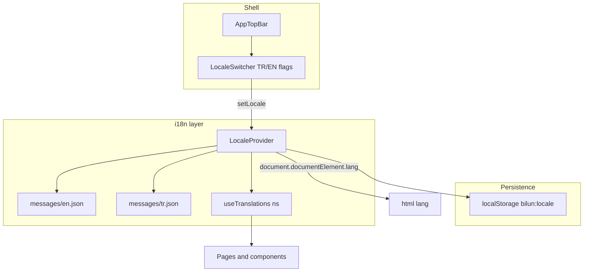

# Plan: English default + Turkish localization (frontend)

## Goal

Ship a bilingual BILUN UI with **English as the default** and an optional **Turkish mode** toggled from a **flag control in the top-right app bar** (`AppTopBar`). The choice persists across sessions. Product copy, labels, placeholders, errors, and empty states translate; **API/domain codes and SGK regulatory identifiers stay as-is**.

### Success criteria

- Fresh visit loads **English** (`html lang="en"`).
- User clicks **TR flag** → shell + current page copy switch to Turkish without reload (or with a single soft navigation if required).
- Choice survives refresh (`localStorage` + optional cookie).
- Tab nav, modals, patient workspace, billing tables, reference tools, and chat **chrome** are translated in TR mode.
- Number/currency formatting follows locale (`en-US` vs `tr-TR`).
- Vitest coverage for locale provider + switcher + at least one translated screen per phase.
- No regression to English-only flows when locale is `en`.

---

## Current state (audit)

| Item | Status |
|------|--------|
| i18n library | **None** — all strings hardcoded English |
| Root HTML lang | Fixed `lang="en"` in `src/app/layout.tsx` |
| Shell / top-right | `src/components/shell/AppTopBar.tsx` — logo left; demo chip + tabs + “How it works” right |
| Centralized copy | Partial — `src/lib/constants.ts`, `sutLabels.ts`, `copayExemption.ts`, `shared.tsx` |
| Turkish today | Domain labels only (e.g. copay categories in `copayExemption.ts`), not full UI |
| Backend labels | `ConfigProvider` → `/api/frontend-config` returns **English** severity/risk labels |
| Chat | UI strings in `SutInlineAIPanel.tsx`; LLM already follows user language server-side |
| Scope estimate | **~800–1,200** distinct UI strings across ~54 production TSX files |

---

## Recommended approach

### V1 — Client-first i18n (recommended for first release)

Avoid moving every route under `app/[locale]/` in the first pass. BILUN is an authenticated internal workspace; locale toggle UX matters more than localized URLs.

**Stack:**

- JSON message catalogs: `frontend/messages/en.json`, `frontend/messages/tr.json`
- `LocaleProvider` + `useLocale()` / `useTranslations(namespace)` hook
- Zustand slice or React context for `locale: 'en' | 'tr'`
- Persist: `localStorage` key `bilun:locale` (default `'en'`)
- `LocaleSwitcher` in `AppTopBar` (right side, before or after “How it works”)

**Why not full `next-intl` + `[locale]` routing in v1?**

- Most UI is `"use client"`; route-based i18n adds middleware, layout moves, and link refactors with limited benefit for v1.
- Flag toggle maps naturally to client state.
- We can migrate to `next-intl` later without throwing away JSON catalogs.

**V2 (optional later):** Adopt `next-intl` with `localePrefix: 'never'` or `app/[locale]/` if shareable localized URLs or SSR metadata per locale become requirements.

---

## Architecture



### File layout (new)

```
frontend/
  messages/
    en.json          # nested keys: shell, tabs, patients, chat, ...
    tr.json
  src/lib/i18n/
    types.ts         # Locale = 'en' | 'tr'
    messages.ts      # load + type-safe key paths (optional)
    LocaleProvider.tsx
    useTranslations.ts
    formatters.ts    # fmtTRY, dates — locale-aware wrappers
  src/components/shell/
    LocaleSwitcher.tsx
```

### Message key convention

Nested namespaces mirroring product areas:

```json
{
  "shell": {
    "howItWorks": "How it works",
    "skipToContent": "Skip to main content"
  },
  "tabs": {
    "patients": { "label": "Patients", "subtitle": "..." }
  },
  "chat": {
    "placeholderPatient": "Ask BILUN about this patient or billing review...",
    "analysisTitle": "BILUN Analysis"
  }
}
```

Use **stable keys**, not English text as keys. Interpolate dynamic values: `"Showing {count} patients"`.

### Locale switcher UX

**Placement:** `AppTopBar` right cluster:

```
[SyntheticDemoChip] [Patients | Compliance | Revenue | Reference Tools] [🇬🇧 EN | 🇹🇷 TR] [How it works]
```

**Behavior:**

- Two icon buttons or segmented control with flag emoji / SVG + `aria-label` (“Switch to Turkish” / “Switch to English”).
- Active locale visually highlighted (gold border or filled chip — match existing design tokens).
- Switching locale:
  1. Updates provider state + `localStorage`
  2. Sets `document.documentElement.lang` to `en` or `tr`
  3. Does **not** clear chat sessions (unless we explicitly decide otherwise)
  4. Does **not** re-fetch patient data

**Default:** `en` when no stored preference.

---

## Special cases

### 1. Backend-driven labels (`ConfigProvider`)

`/api/frontend-config` returns English labels today (`dusuk` → “Low”, etc.).

**V1 options (pick one in implementation):**

| Option | Effort | Notes |
|--------|--------|-------|
| **A. Frontend override map** | Low | Keep API keys; map `dusuk/orta/yuksek/kritik` to `t('severity.low')` in UI |
| **B. API `?locale=tr`** | Medium | Extend backend config endpoint — cleaner long-term |

**Recommendation:** **Option A** for v1; log Option B as follow-up.

### 2. Numbers and currency

Today: `SUT_PRIMARY_LOCALE = "en-US"` in `tabs/sut/shared.tsx`.

- Wrap formatters in `formatters.ts` reading current locale.
- `en` → `en-US`; `tr` → `tr-TR` for `Intl.NumberFormat` / `Intl.DateTimeFormat`.
- TRY suffix stays `TRY` / `₺` per design (confirm with product — plan assumes `1.234,56 TRY` style in TR).

### 3. Chat UI vs LLM output

| Layer | Translate? |
|-------|------------|
| Chat panel chrome (titles, placeholders, buttons, errors) | **Yes** |
| `DEFAULT_PROMPTS` (auto-brief system prompts sent to API) | **Yes** — Turkish prompts when locale is `tr` |
| Assistant message content from LLM | **No** — backend already matches user language; re-brief on locale change is optional |

### 4. Regulatory / domain text

Keep **unchanged** in both locales unless a curated TR glossary exists:

- ICD codes, procedure codes, EK annex IDs (`EK-1A`, `EK-2B`, …)
- Patient IDs, exactness enum values sent to API
- Copay category **codes**; translate **display labels** via i18n (unify with existing Turkish strings in `copayExemption.ts`)

### 5. Fonts

Inter/Fraunces use `latin` subset only. Before TR launch, extend Google font subsets to **`latin-ext`** (covers Turkish diacritics: ç, ğ, ı, ö, ş, ü).

### 6. Tests

- Update tests that assert English strings → use `renderWithLocale(ui, 'en')` helper.
- Add TR snapshot or key assertion tests for shell + one heavy screen.
- Locale switcher: click TR → expect Turkish tab label.

### 7. Design system page

**Out of v1 scope** (`app/design-system/page.tsx`) — dev-only.

---

## Phased migration

Work in vertical slices so each phase is shippable and testable.

### Phase 0 — Foundation (1–2 days)

- [ ] Add `messages/en.json` + `messages/tr.json` (shell keys only)
- [ ] `LocaleProvider`, `useTranslations`, `formatters.ts`
- [ ] Wire provider in `src/stores/providers.tsx` (inside `ConfigProvider`)
- [ ] `LocaleSwitcher` in `AppTopBar`
- [ ] Dynamic `html lang` (client effect; static `en` fallback in root layout)
- [ ] Unit tests for provider + switcher persistence

### Phase 1 — Shell & navigation (1 day)

- [ ] `AppTopBar`: tabs, “How it works”, aria labels
- [ ] `layout.tsx`: skip link, metadata titles/descriptions (client or split metadata per locale in v2)
- [ ] `constants.ts`: migrate `SUT_HOME_TABS`, `SUT_BRAND` user-facing strings to message keys
- [ ] `SutHowItWorksModal.tsx`
- [ ] `error.tsx`

### Phase 2 — Home workspace (2–3 days)

- [ ] `SutWorkspaceLanding.tsx`, `CohortFilterBar.tsx`, `PatientSearch.tsx`
- [ ] Tab bodies: `SUTPatients.tsx`, `SUTCompliance.tsx`, `SUTRevenue.tsx`, `SUTReferenceTools.tsx`
- [ ] `sutLabels.ts`, severity/risk display helpers

### Phase 3 — Patient flows (2–3 days)

- [ ] `SutPatientWorkspace.tsx`, `patient/[id]/page.tsx`, billing page
- [ ] `SutBillingReportSections.tsx` (largest table copy block)
- [ ] `PatientInvoiceTable.tsx`, breadcrumbs, empty/loading states

### Phase 4 — Reference tools & optimizer (3–4 days)

- [ ] `SUTOptimizerTab.tsx` (largest single file)
- [ ] `sections/*.tsx` (Claim validator, DRG pricing, catalogs, …)
- [ ] `ToolsSection.tsx`, `shared.tsx` (`Unavailable`, tooltips)

### Phase 5 — Chat & admin (1 day)

- [ ] `SutInlineAIPanel.tsx` UI + localized `DEFAULT_PROMPTS`
- [ ] `sutChat.ts` user-facing errors
- [ ] `SutHealthPanel.tsx`, `SyntheticDemoProvenance.tsx`

### Phase 6 — QA & polish (1–2 days)

- [ ] Full manual pass: EN default, TR toggle on all routes
- [ ] Fix truncation / layout overflow (Turkish strings often longer)
- [ ] Font subset update
- [ ] Document locale behavior in README or AGENTS note

**Total estimate:** ~10–14 dev days for full coverage; **Phases 0–1 alone** deliver visible switcher + shell (~2–3 days).

---

## Out of scope (v1)

- Backend `/api/frontend-config` locale parameter
- Localized URLs (`/tr/patient/...`)
- Translating LLM responses (model handles this)
- RTL or languages beyond EN/TR
- Translating synthetic demo data / API payload content (diagnosis names, drug names from backend)
- CMS-style translation workflow / Crowdin integration

---

## Risks & mitigations

| Risk | Mitigation |
|------|------------|
| Large string surface (~1k strings) | Phased migration; start with centralized constants |
| Turkish longer than English breaks layout | QA pass; allow `text-balance` / flexible widths in nav |
| Tests brittle on copy | `renderWithLocale` test helper; assert keys not prose where possible |
| Duplicate TR strings (`copayExemption.ts`) | Consolidate into `tr.json`; code maps code → `t(...)` |
| Chat auto-brief language mismatch | Localize `DEFAULT_PROMPTS`; optional re-fire brief on locale change (defer unless requested) |

---

## Implementation gate (before coding)

1. ~~Confirm **flag UI**~~ → 🇬🇧/🇹🇷 flags in AppTopBar
2. ~~Confirm **TRY display**~~ → `₺1.234` in TR locale
3. ~~Confirm **chat auto-brief**~~ → re-run on locale change (clears thread, Turkish prompts)
4. ~~Approve scope~~ → full migration (in progress — see `tasks/todo.md`)

### Implementation status (2026-05-30)

| Area | Status |
|------|--------|
| i18n core (`src/lib/i18n/*`, `src/messages/en|tr/*`) | Done |
| Flag switcher + persistence | Done |
| Shell, chat, home landing, cohort filters | Done |
| ₺ formatters | Done |
| Optimizer, sections, billing, patient pages | Next pass |

---

## Related files (starting points)

| Purpose | Path |
|---------|------|
| Top bar / switcher host | `frontend/src/components/shell/AppTopBar.tsx` |
| Provider tree | `frontend/src/stores/providers.tsx`, `frontend/src/app/layout.tsx` |
| Tab labels | `frontend/src/lib/constants.ts` |
| Shared formatters | `frontend/src/components/tabs/sut/shared.tsx` |
| Chat copy | `frontend/src/components/chat/SutInlineAIPanel.tsx` |
