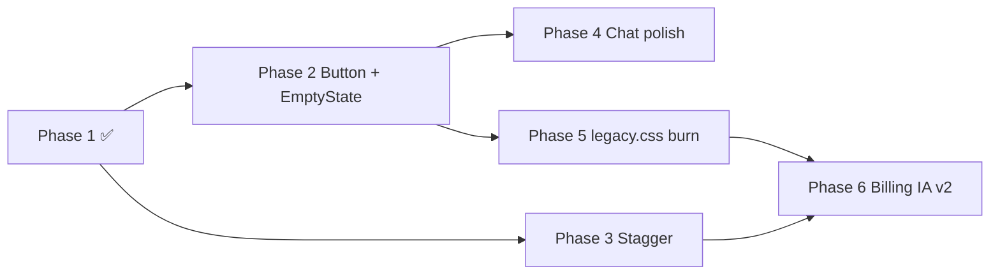

# Frontend Premium UI — Enhancement Plan

> **Status:** Phase 1 shipped in [PR #8](https://github.com/Safa675/Bilun/pull/8) (`feat/frontend-premium-ui`). Phases 2–6 below are **not started**.
>
> **Supersedes / extends:** `plans/frontend/premium-ui-phase1.md` (Phase 1 checklist only), `plans/frontend/frontend-rebuild.md` (2026 rebuild phases 1–6 complete), `plans/frontend/legacy-css-dead-code-removal.md` (partial overlap on CSS burn-down).
>
> **Design contract:** Locked palette + typography in `plans/frontend/frontend-rebuild.md`. No backend/API changes unless a product IA item explicitly needs new data (called out per phase).

---

## Goal

Continue the quiet-premium product polish started in Phase 1: finish the primitive layer, retire remaining `legacy.css` button/empty-state classes, restore restrained motion, and tighten billing + chat UX so the frontend reads as one coherent design system — not a mix of Tailwind primitives and transitional CSS.

---

## Baseline — Phase 1 (done)

| Area | What shipped |
|---|---|
| Primitives | `ExactnessBlock`, `EmptyState` added; `Surface.interactive` |
| Typography / density | Quieter `.bilun-data-table` headers; KPI values `text-2xl`; `sut-app-main` top padding |
| Brand | Login `BilunWordmark` + elevated card shadow |
| i18n | `fmtDate()` — locale-aware dates in `BillPicker`, `OriginalBillView` |
| Patient billing IA | Section groups (overview / compliance / opportunities / reference); financial summary follows bill scope; `?claim=` URL sync; default **all bills**; bill switch keeps report visible (opacity overlay) |
| Work queue | Recommended actions sorted by amount; row click scrolls to anchored sections |

**Still stubbed / partial after Phase 1:**
- `useStaggeredReveal` — no-op (interface preserved)
- `EmptyState` — exists but **not adopted**; `PatientSection` still uses `.empty-state`
- Buttons — still `sut-btn-*` / `sut-section-btn` in `legacy.css` (~15 call sites)
- Chat — `SutInlineAIPanel` tokenized but not aligned to new primitives; page context exists but billing sections not fully mirrored
- `SutBillingReportSections` — many inline `sut-exactness-notice` divs; `sut-status-chip` on priority badge

---

## PR strategy

| PR | Branch suggestion | Scope | Risk |
|---|---|---|---|
| **#8** | `feat/frontend-premium-ui` | Phase 1 | Low — merged pending review |
| **#9** | `feat/frontend-button-empty-state` | Phase 2 | Low — mechanical migration |
| **#10** | `feat/frontend-stagger-motion` | Phase 3 | Medium — motion + a11y |
| **#11** | `feat/frontend-chat-polish` | Phase 4 | Medium — UX + context |
| **#12** | `feat/frontend-legacy-css-burn` | Phase 5 | Low — delete CSS after migrations |
| **#13** | `feat/frontend-billing-ia-v2` | Phase 6 | Medium — product behavior |

Each PR should pass `npm run lint`, `npm run typecheck`, `npm test`, `npm run build` in `frontend/`.

---

## Phase 2 — Primitives completion (Button + EmptyState adoption)

**Goal:** One canonical button and empty-state API; zero new JSX references to `sut-btn-*`, `sut-section-btn`, `.empty-state`.

### Subtasks

- [ ] Add `Button` primitive (`frontend/src/components/primitives/Button.tsx`)
  - Variants: `primary` | `secondary` | `ghost` | `icon`
  - Sizes: `default` | `compact` (maps today’s `sut-section-btn-compact`)
  - States: `disabled`, `loading` (optional spinner slot)
  - `asChild` or explicit `Link` wrapper pattern for nav buttons (match existing `error.tsx`, `SutPatientWorkspace` links)
- [ ] Export from `primitives/index.ts`; add Storybook-style examples on `/design-system` if that route still exists
- [ ] Migrate call sites (~15 files), priority order:
  1. `PatientSection.tsx` — retry buttons + **replace `.empty-state` with `<EmptyState>`**
  2. `login/page.tsx` — `sut-btn-primary` → `<Button variant="primary">`
  3. `ClaimValidatorSection.tsx`, `MaterialPricingSection.tsx` — primary/secondary/icon
  4. Rule database panels (`ClauseBrowserPanel`, `SectionBrowserPanel`, `RuleList`, `RuleDatabaseSection`)
  5. `ToolsSection`, `CohortFilterBar`, `PatientSearch`, `DrugCatalogSection`, `error.tsx`, `SutPatientWorkspace`
- [ ] Add `LoadingState` primitive (optional thin wrapper) OR extend `EmptyState` with `loading` prop — replace any remaining `.loading-state` / `.loading-spinner` if referenced
- [ ] Delete migrated blocks from `legacy.css`: `.sut-btn-*`, `.sut-section-btn*`, `.empty-state*`
- [ ] Update vitest mocks: tests that stub `useStaggeredReveal` unchanged; add `Button` snapshot only if existing pattern warrants it

### Success criteria

- `rg 'sut-btn-|sut-section-btn|empty-state' frontend/src --glob '*.{tsx,ts}'` → 0 JSX hits (CSS file excluded until Phase 5 cleanup PR)
- Visual parity on login, patient list empty, claim validator actions

### Out of scope

- `Tabs` primitive refactor (already exists)
- Changing button copy or i18n keys

---

## Phase 3 — Stagger motion (re-enable `useStaggeredReveal`)

**Goal:** Subtle enter animation on list/card reveals without the old “AI template” glow/lift. Respect `prefers-reduced-motion`.

### Subtasks

- [ ] Re-implement `frontend/src/hooks/useStaggeredReveal.ts`:
  - `IntersectionObserver` + CSS custom properties (`--stagger-delay`) or Tailwind `animate-in` utilities
  - Variants: `fade` (default), `scale` (optional, very subtle)
  - `enabled: false` and `prefers-reduced-motion: reduce` → current no-op behavior
- [ ] Add minimal CSS in `globals.css` (keyframes only; no new legacy classes)
- [ ] Wire callers (5 TSX files today):
  - `PatientSection.tsx`
  - `SUTAnalyticsShell.tsx`
  - `SUTOptimizerTab.tsx` (2 call sites)
- [ ] Tune defaults: `baseDelayMs: 40`, `stepMs: 140`, `threshold: 0.15` (match existing call sites)
- [ ] Unit test: mock `matchMedia` for reduced-motion path returns empty `staggerClass`

### Success criteria

- Cards fade in on scroll on home patient list and optimizer KPI rows
- With `prefers-reduced-motion: reduce`, no animation, no layout shift
- Existing vitest mocks continue to pass (or update mocks to test real hook in dedicated test file)

### Out of scope

- Page-transition animations
- Re-adding `dashboardEnter` / `sutPremiumEnter` keyframes (explicitly banned per rebuild contract)

---

## Phase 4 — Chat panel polish + context enrichment

**Goal:** Chat feels native to the billing workspace; dev chat receives the same scope the user sees on screen.

### Subtasks

- [ ] **Visual polish** (`SutInlineAIPanel.tsx`):
  - Use `<Button variant="icon">` for dock/minimize/reset/send (after Phase 2)
  - Message bubbles on `<Surface variant="soft">` / base
  - Prompt chips row uses `<Chip>` primitive
  - Fixed width `380px` unchanged; verify dock insets with `ChatDockInsetSync`
- [ ] **Context enrichment** (`sutChatPageContext.ts` + patient `page.tsx`):
  - When `?claim=` set, include `claim_id` + bill-scoped `visible_billing` (already partially there via `buildVisibleBillingSnapshot`)
  - Add `selected_section` when user lands via `?section=` or recommended-action scroll
  - Pass top 3 `recommended_actions` titles + amounts into `sections.recommended_actions`
- [ ] **Prompt defaults** — ensure `resolvePromptKey` covers billing review with bill scope (EN/TR in `messages/*/chat.ts`)
- [ ] **Empty / error states** — use `<EmptyState>` for no-messages and failed-send retry
- [ ] Manual test: open patient → select bill → ask “what should I fix first?” — context JSON includes `claim_id` and recoverable total

### Success criteria

- Chat panel uses primitives only (no ad-hoc border/radius duplicates)
- `formatSutChatContextPrompt` output includes bill scope when a claim is selected
- No regression on center vs left/right dock

### Out of scope

- New LLM capabilities or backend chat routes
- Streaming UI overhaul (keep current cursor blink unless broken)

---

## Phase 5 — `legacy.css` burn-down

**Goal:** Delete `legacy.css` entirely or reduce to ≤50 lines of unavoidable globals. Current size: **~252 lines**.

### Subtasks

- [ ] Execute dead-code removal from `plans/frontend/legacy-css-dead-code-removal.md` (re-audit class list — file may have shrunk since plan was written)
- [ ] Migrate live classes still in JSX:
  | Class family | Migration target |
  |---|---|
  | `sut-status-chip` | `<Chip variant="…">` in `SutBillingReportSections` |
  | `sut-exactness-notice` | `<ExactnessBlock>` (bulk replace in billing sections) |
  | `sut-input`, `app-select`, `patient-search-input` | Input primitive or Tailwind form tokens |
  | `sut-filter-control`, `sut-page-jump-control` | Optimizer toolbar utilities |
  | `sut-section-divider*` | `<Section>` subheading or `<Eyebrow>` |
  | `glass` | `<Surface>` on `PatientSearch` |
- [ ] After zero JSX references: delete `legacy.css` import from `layout.tsx` / `globals.css`
- [ ] Run full vitest + `next build`; grep repo for deleted class names

### Success criteria

- `legacy.css` deleted OR ≤50 lines with comment explaining why each rule remains
- `rg 'sut-status-chip|sut-exactness-notice|sut-input' frontend/src` → 0

### Out of scope

- `sut-how-modal.css` (separate file; modal-specific)
- `globals.css` token restructure (already ~266 lines — acceptable)

---

## Phase 6 — Billing product IA v2

**Goal:** Close remaining gaps from the aesthetic / product review after per-bill redesign (`plans/frontend/patient-profile-per-bill-redesign-plan.md`).

### Subtasks

- [ ] **OriginalBillView line highlighting** — highlight lines referenced by the selected recommended action (procedure/material code match)
- [ ] **Section deep links** — persist `?section=` in URL when scrolling via work queue (today: scroll only on click; no URL write-back)
- [ ] **Exactness consistency** — all billing sections use `ExactnessBlock`; remove duplicate notice markup in `SutBillingReportSections.tsx`
- [ ] **Gold discipline audit** — re-run max-2-gold rule on patient page after IA changes (primary recoverable + one H1 em)
- [ ] **Optimizer tab** — cap grid cols (Phase 1 did `xl:grid-cols-4`); audit remaining dense tables for horizontal scroll on 1280px
- [ ] **Empty states** — drug catalog, rule database, cohort filters: adopt `<EmptyState>` with actionable CTAs

### Success criteria

- Clicking a recommended action highlights at least one invoice line when code is attributable
- Shareable URL `?claim=X&section=billing-copay` opens correct bill + scrolls to section
- Product review checklist (below) passes on `/patient/{id}`

### Out of scope

- New backend endpoints (per-bill APIs already exist)
- Reverting Phase 1 default to “all bills” (intentional product choice)

---

## Cross-cutting verification checklist

Run before marking any phase done:

- [ ] `cd frontend && npm run lint && npm run typecheck && npm test && npm run build`
- [ ] `/`, `/?tab=optimizer`, `/patient/{multi-claim-id}` — 200, no console errors
- [ ] Locale switch EN ↔ TR — dates, billing scope titles, chat prompts
- [ ] `prefers-reduced-motion` — no stagger (Phase 3+)
- [ ] Print preview — billing report still readable (`globals.css` print rules)

---

## Product review checklist (end state)

| Check | Target |
|---|---|
| Top bar | `AppTopBar` only brand chrome; gold underline on active tab |
| Patient scope | Financial summary title matches all-bills vs single-bill |
| Work queue | Sorted by ₺; click navigates to section |
| Tables | Muted headers, tabular nums, no uppercase shouting |
| Status | Priority/recoverable use tokens, not Tailwind red/amber |
| Chat | Dock does not obscure tabs; context matches on-screen bill |
| Motion | Subtle fade-in only; instant when reduced-motion |
| CSS | No `sut-btn-*`, `frost-*`, `sut-premium-*` in TSX |

---

## Dependencies & ordering

- **Phase 2 before 4** — chat icon buttons should use `Button`
- **Phase 2 + 5** — button CSS deletion blocked until JSX migration
- **Phase 3** can parallel Phase 2 (independent hook)
- **Phase 6** last — builds on ExactnessBlock + EmptyState + URL patterns from Phase 1

---

## Related documents

| Document | Relevance |
|---|---|
| `plans/frontend/frontend-rebuild.md` | Original design contract + 2026 rebuild history |
| `plans/frontend/premium-ui-phase1.md` | Short Phase 1 done list |
| `plans/frontend/legacy-css-dead-code-removal.md` | Dead class audit for Phase 5 |
| `plans/frontend/patient-profile-per-bill-redesign-plan.md` | Backend + frontend per-bill architecture (mostly complete) |
| `plans/frontend/rule-database-improvement-plan.md` | Separate track — rule DB tabs |

---

## Review log

| Date | Note |
|---|---|
| 2026-07-07 | Plan authored on `feat/frontend-premium-ui` after Phase 1 PR #8 opened |
